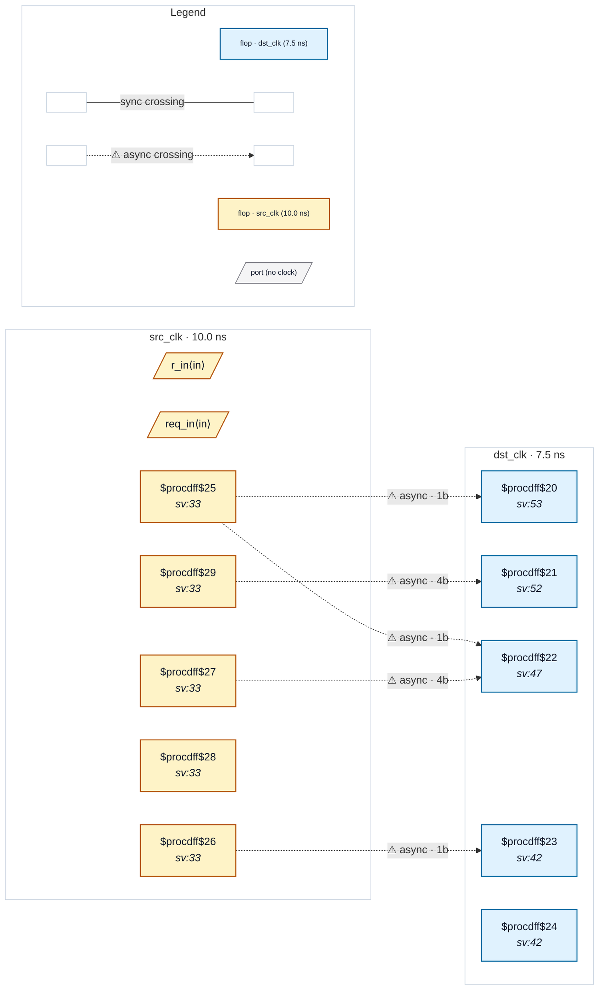

# Fixture: `bad_bus_foreign_sync_reset`

<!-- generator: scripts/gen_fixture_docs.py -->

Buses into dst_clk registers whose synchronous reset comes from another clock domain, in the `proc` and the `opt_dff` form (rtl-buddy-cdc#383).

`r` is a src_clk register used as the synchronous reset of two 4-bit dst_clk registers:

```text
  cap   loads `pay` under `en_s2`, a 2FF-synchronised request, with no
        acknowledge back to src_clk: a gated capture (CDC-012 on pay);
        r -> cap is one bit on all four lanes' reset (CDC-001)
  gq    second stage of a 2FF gray-code bus synchroniser (`gray` ->
        `meta` -> `gq`): accepted; r -> gq is again one unsynchronised
        bit, not a 4-bit bus (CDC-001, rtl-buddy-cdc#390)
  r     RDC-003 (one finding for cap and gq)
```

After `proc` each reset is a constant-leg `$mux` on `D` selected by `r`; after `opt_dff` it is the `SRST` pin (cap: `$sdffe`, gq: `$sdff`). The reset is part of the flop in both forms whatever domain drives it: cap's enable behind it is still the gate, and gq's `D` is still meta's `Q`. Both netlists (`.json`, `.optdff.json`) report the same.

- **Status:** negative — analyzer must report a violation
- **Top module:** `bad_bus_foreign_sync_reset`
- **Clocks:** `dst_clk` (7.5 ns), `src_clk` (10.0 ns)
- **Crossings:** 5 structural (5 async-per-SDC, 0 sync)

## Clock-domain map



## Files

- `bad_bus_foreign_sync_reset.json`
- `bad_bus_foreign_sync_reset.optdff.json`
- `bad_bus_foreign_sync_reset.sdc`
- `bad_bus_foreign_sync_reset.sv`

---
*Generated by `scripts/gen_fixture_docs.py` — re-run after editing the SV/SDC/netlist.*
