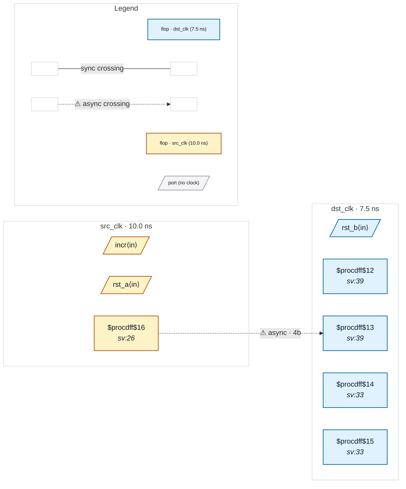

# Fixture: `bad_bus_sync_local_srst`

<!-- generator: scripts/gen_fixture_docs.py -->

Binary (not gray) counter into a multi-bit 2FF synchroniser whose stages carry a synchronous reset from a dst_clk register (rtl-buddy-cdc#376).

After `proc` the reset is a constant-leg `$mux` in front of each stage's `D`, selected by a dst_clk flop. That is the same shape as a load-enable mux selected by a synchronised valid, but a reset only forces the lanes to zero: between resets the first stage samples the bus on every edge, so several bits can settle on different cycles and the captured value can be one the source never held. CDC-004 must fire, on the `proc` netlist and on the `.optdff.json` netlist (the same design after `opt_dff`, where each reset is a `$sdff`) alike.

Paired with `good_gray_bus_sync_srst` (gray source, same stages).

- **Status:** negative — analyzer must report a violation
- **Top module:** `bad_bus_sync_local_srst`
- **Clocks:** `dst_clk` (7.5 ns), `src_clk` (10.0 ns)
- **Crossings:** 1 structural (1 async-per-SDC, 0 sync)

## Clock-domain map

## Files

- `bad_bus_sync_local_srst.json`
- `bad_bus_sync_local_srst.optdff.json`
- `bad_bus_sync_local_srst.sdc`
- `bad_bus_sync_local_srst.sv`

---
*Generated by `scripts/gen_fixture_docs.py` — re-run after editing the SV/SDC/netlist.*
