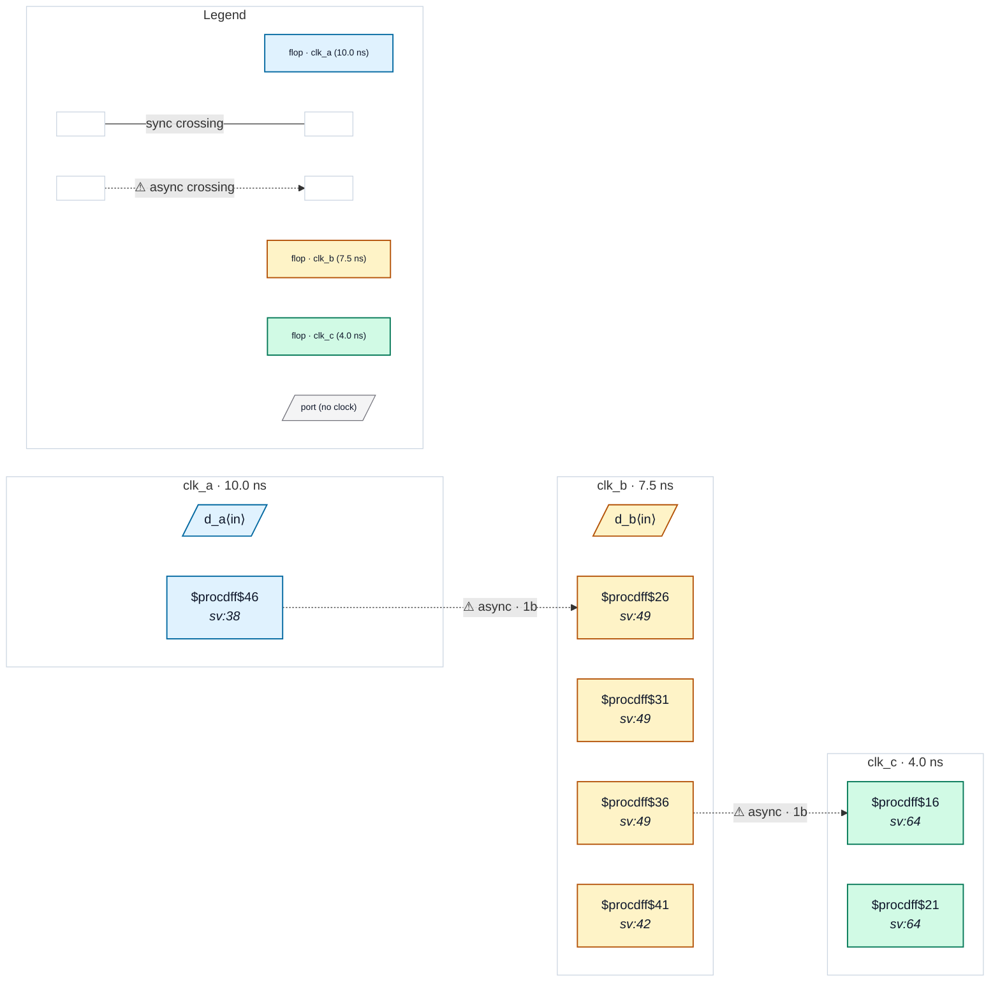

# Fixture: `bad_case_analysis_mode_sel1`

<!-- generator: scripts/gen_fixture_docs.py -->

Negative fixture: set_case_analysis selects the clock-mux leg that makes a raw path a crossing (rtl-buddy-cdc#331).

Same RTL as good_case_analysis_mode_sel0: block M runs on clk_m = ~mode[1] ? clk_a : clk_b and captures a_q (clk_a) with a single flop, b_q (clk_b) through a 2FF synchroniser, and sends the synchronised b_q on to clk_c through a 2FF synchroniser. The SDC pins the other mode: `set_case_analysis 1 [get_ports {mode[1]}]`, so clk_m is clk_b. Now the raw a_q → m_cap path is an asynchronous crossing and CDC-001 fires exactly once on it; the b_q synchroniser becomes a same-domain pipeline (not a crossing) and clk_m → clk_c stays a clean 2FF. m_cap feeds only an output port, so the finding is the missing second stage (CDC-001), not logic between stages.

```text
  clk_a ─┐                 [a_q] clk_a ──1FF──▶ [m_cap]   → CDC-001
  clk_b ─┴─ mux(~mode[1]) = clk_m   [b_q] clk_b ──2FF──▶ M   same domain
                                     M ──2FF──▶ clk_c
```

- **Status:** negative — analyzer must report a violation
- **Top module:** `bad_case_analysis_mode_sel1`
- **Clocks:** `clk_a` (10.0 ns), `clk_b` (7.5 ns), `clk_c` (4.0 ns)
- **Crossings:** 2 structural (2 async-per-SDC, 0 sync)

## Clock-domain map



## Files

- `bad_case_analysis_mode_sel1.json`
- `bad_case_analysis_mode_sel1.sdc`
- `bad_case_analysis_mode_sel1.sv`

---
*Generated by `scripts/gen_fixture_docs.py` — re-run after editing the SV/SDC/netlist.*
