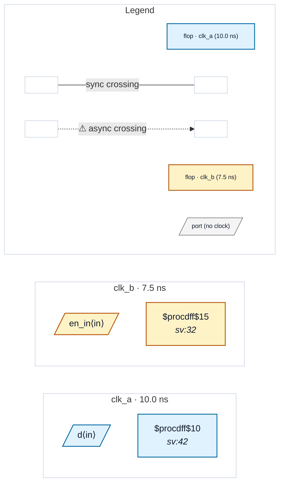

# Fixture: `bad_clock_gating_async_enable`

<!-- generator: scripts/gen_fixture_docs.py -->

Negative-case fixture: a raw-AND clock gate whose enable is a flop in a clock domain asynchronous to the gated clock.

Hazard: the enable transitions asynchronously to `clk_a`, so the AND output can chop the gated clock into runt pulses every time the enable changes. The downstream flop sees a clock with arbitrarily short high phases — every flop on this clock branch is at risk.

CDC-010 fires on the $and's enable leg B. A bare $and has no named control pin; the clock-root walk reads leg A as the clock (clk_a) and leg B as the enable, and CDC-010 checks the leg the walk reads as control. The enable flop's Q is NOT a second clock: before rtl-buddy-cdc#408 the walk followed it back to clk_b as a divided clock and reported a two-clock combine (CDC-023, warning) instead of the async enable (CDC-010, error).

See issue #177 and rtl-buddy-cdc#408.

- **Status:** negative — analyzer must report a violation
- **Top module:** `bad_clock_gating_async_enable`
- **Clocks:** `clk_a` (10.0 ns), `clk_b` (7.5 ns)
- **Crossings:** 0 structural (0 async-per-SDC, 0 sync)

## Clock-domain map

## Files

- `bad_clock_gating_async_enable.json`
- `bad_clock_gating_async_enable.sdc`
- `bad_clock_gating_async_enable.sv`

---
*Generated by `scripts/gen_fixture_docs.py` — re-run after editing the SV/SDC/netlist.*
