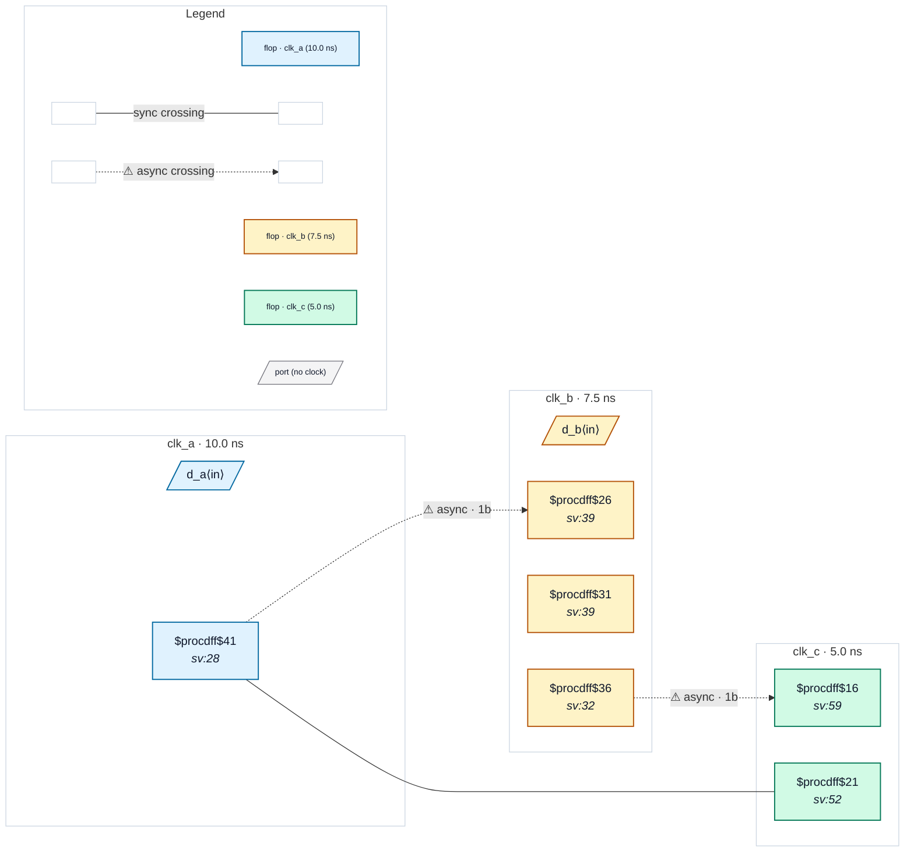

# Fixture: `bad_clock_groups_two_statements`

<!-- generator: scripts/gen_fixture_docs.py -->

Negative fixture: asynchrony declared by two separate set_clock_groups statements, with one async hop unsynchronised (rtl-buddy-cdc#331).

Same SDC as good_clock_groups_two_statements: clk_a / clk_b are asynchronous by one statement, clk_b / clk_c by another, and no statement separates clk_a from clk_c. The clk_b → clk_c hop is now a single capture flop: the second statement makes that pair asynchronous, so CDC-001 fires exactly once (b_q → c_s1). The raw clk_a → clk_c capture stays silent (the two clocks are never declared asynchronous) and clk_a → clk_b keeps its 2FF synchroniser.

```text
  [a_q] clk_a ──2FF──▶ clk_b [b_q] ──1FF──▶ clk_c   → CDC-001
  [a_q] clk_a ───────raw─────────────────▶ clk_c [c_cap]
```

- **Status:** negative — analyzer must report a violation
- **Top module:** `bad_clock_groups_two_statements`
- **Clocks:** `clk_a` (10.0 ns), `clk_b` (7.5 ns), `clk_c` (5.0 ns)
- **Crossings:** 3 structural (2 async-per-SDC, 1 sync)

## Clock-domain map



## Files

- `bad_clock_groups_two_statements.json`
- `bad_clock_groups_two_statements.sdc`
- `bad_clock_groups_two_statements.sv`

---
*Generated by `scripts/gen_fixture_docs.py` — re-run after editing the SV/SDC/netlist.*
