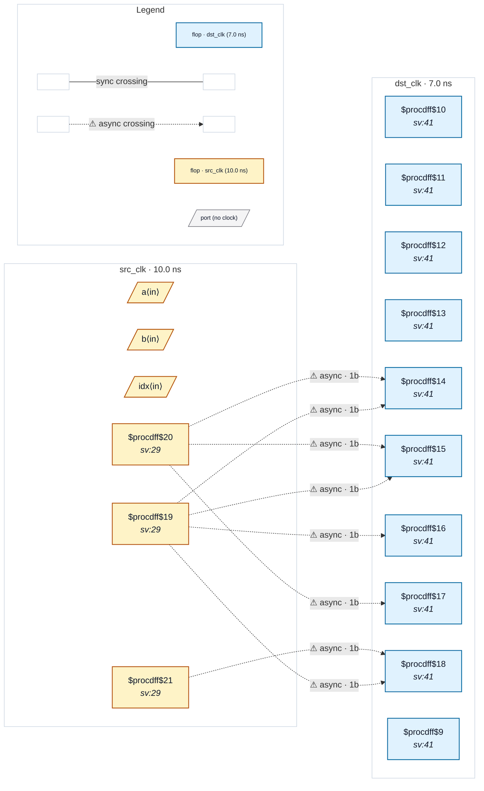

# Fixture: `bad_comb_ops_before_sync`

<!-- generator: scripts/gen_fixture_docs.py -->

Wider combinational operators before synchronisers (rtl-buddy-cdc#331).

Five status bits are computed from the src_clk registers a_q, b_q and idx_q in front of five 2FF synchronisers, one operator family each: `$mul` + `$reduce_or` (|(a_q * b_q)), `$lt` (a_q < b_q), `$reduce_xor` (^a_q), `$reduce_and` (&b_q) and `$shiftx` (a_q[idx_q]). Every source register reaching a synchroniser through that logic is a CDC-003: eight crossings, eight findings. a_q and b_q each reach several independent synchronisers, so CDC-020 fires once for each.

Known gap, pinned as a strict xfail: the slang frontend does not lower the run-time index read a_q[idx_q]. It warns and models it as an opaque driver, so slang finds six crossings instead of eight.

- **Status:** negative — analyzer must report a violation
- **Top module:** `bad_comb_ops_before_sync`
- **Clocks:** `dst_clk` (7.0 ns), `src_clk` (10.0 ns)
- **Crossings:** 8 structural (8 async-per-SDC, 0 sync)

## Clock-domain map

## Files

- `bad_comb_ops_before_sync.json`
- `bad_comb_ops_before_sync.sdc`
- `bad_comb_ops_before_sync.sv`

---
*Generated by `scripts/gen_fixture_docs.py` — re-run after editing the SV/SDC/netlist.*
