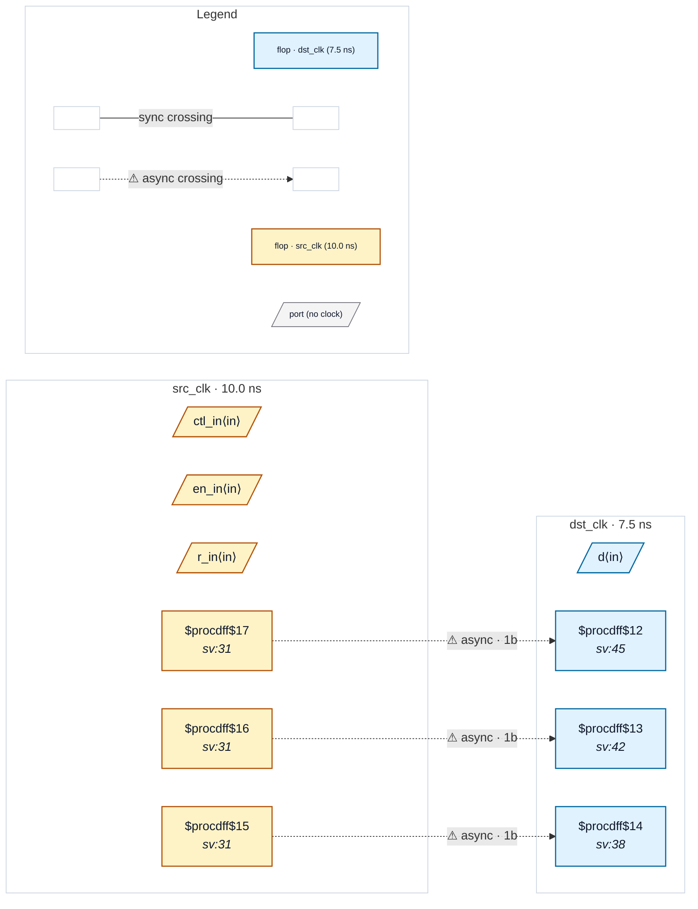

# Fixture: `bad_control_bit_fanout`

<!-- generator: scripts/gen_fixture_docs.py -->

One foreign control bit fanned out to every lane of a register (rtl-buddy-cdc#390).

```text
  q_r  4-bit, sync reset from `r`, a src_clk register    CDC-001, RDC-003
  q_e  4-bit, enable from `en`, a src_clk register       CDC-001
  q_c  4-bit, enable from `ctl[0]`, one bit of a 2-bit   CDC-001
       src_clk register
```

Every lane sees the same bit, so there is no inter-bit skew to be incoherent: each is a single-bit crossing that a 2FF synchroniser on the control fixes, not a bus needing gray code or a handshake. They were W-bit bus crossings (CDC-004), because the walk reaches every `D` lane through the reset / enable mux select (or the `SRST` / `EN` pin it is folded into). The committed `.optdff.json` (`$sdff` / `$dffe`) and `.synth.json` (gate level) must agree.

- **Status:** negative — analyzer must report a violation
- **Top module:** `bad_control_bit_fanout`
- **Clocks:** `dst_clk` (7.5 ns), `src_clk` (10.0 ns)
- **Crossings:** 3 structural (3 async-per-SDC, 0 sync)

## Clock-domain map



## Files

- `bad_control_bit_fanout.json`
- `bad_control_bit_fanout.optdff.json`
- `bad_control_bit_fanout.sdc`
- `bad_control_bit_fanout.sv`
- `bad_control_bit_fanout.synth.json`

---
*Generated by `scripts/gen_fixture_docs.py` — re-run after editing the SV/SDC/netlist.*
