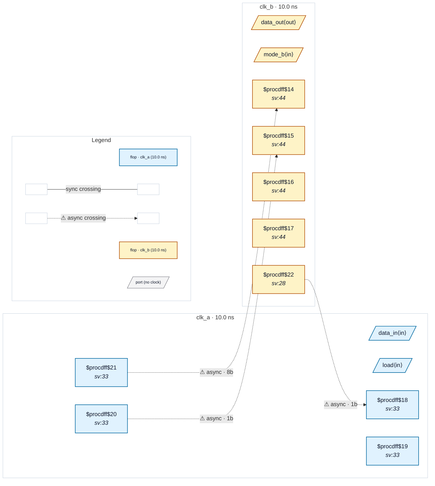

# Fixture: `bad_datahold_dst_mode_bit`

<!-- generator: scripts/gen_fixture_docs.py -->

Negative fixture: a destination-domain signal reaches the source payload's value, but nothing holds the payload (rtl-buddy-cdc#369).

clk_a and clk_b are asynchronous. clk_a loads an 8-bit payload on `load` and toggles a request; clk_b synchronises the toggle (2FF plus a third stage for edge detection) and captures the payload on each edge, so the bus crossing is gated (no CDC-004). A mode bit from clk_b is synchronised into clk_a (2FF) and inverts the payload as it is loaded. That is a path from clk_b back into the payload register, but it only changes *what* is stored: `load` can fire again while clk_b is still sampling, so the payload is not held. Expected verdict: CDC-012 on data_a, nothing else.

```text
  clk_b [m_b] ──2FF──▶ clk_a [m2] ──value──▶ [data_a] ──gated──▶ clk_b
  clk_a [tog_a] ──3FF──▶ clk_b (edge → load enable)
```

- **Status:** negative — analyzer must report a violation
- **Top module:** `bad_datahold_dst_mode_bit`
- **Clocks:** `clk_a` (10.0 ns), `clk_b` (10.0 ns)
- **Crossings:** 3 structural (3 async-per-SDC, 0 sync)

## Clock-domain map



## Files

- `bad_datahold_dst_mode_bit.json`
- `bad_datahold_dst_mode_bit.sdc`
- `bad_datahold_dst_mode_bit.sv`

---
*Generated by `scripts/gen_fixture_docs.py` — re-run after editing the SV/SDC/netlist.*
