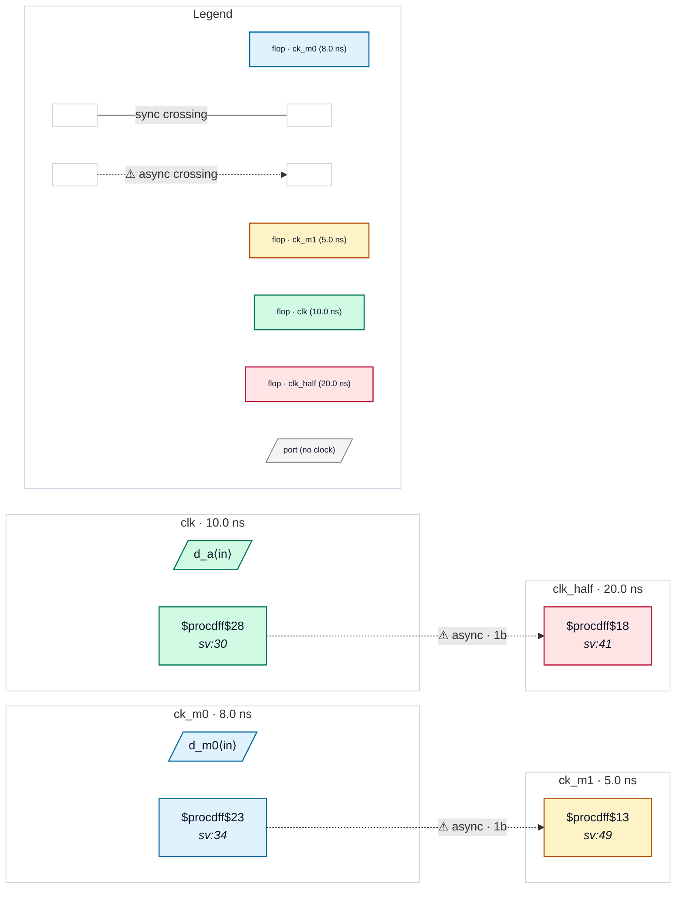

# Fixture: `bad_datapath_only_overrides`

<!-- generator: scripts/gen_fixture_docs.py -->

Negative fixture: set_max_delay -datapath_only overriding a generated clock relation and an exclusive group, with raw captures (rtl-buddy-cdc#331).

Same SDC as good_datapath_only_overrides: clk_half is a -divide_by 2 generated clock of clk, ck_m0 / ck_m1 are -physically_exclusive, and each pair carries a clock-to-clock set_max_delay -datapath_only. The datapath-only bound makes each pair an intended asynchronous crossing (it wins over the generated collapse and is never unreachable), so a single capture flop is a missing synchroniser in both places. Without the bound, the first raw capture would be a synchronous path and the second an unreachable one, both silent. Exactly two CDC-001.

```text
  [a_q] clk   ──1FF──▶ clk_half   → CDC-001
  [m0_q] ck_m0 ──1FF──▶ ck_m1      → CDC-001
```

- **Status:** negative — analyzer must report a violation
- **Top module:** `bad_datapath_only_overrides`
- **Clocks:** `ck_m0` (8.0 ns), `ck_m1` (5.0 ns), `clk` (10.0 ns), `clk_half` (20.0 ns)
- **Crossings:** 2 structural (2 async-per-SDC, 0 sync)

## Clock-domain map



## Files

- `bad_datapath_only_overrides.json`
- `bad_datapath_only_overrides.sdc`
- `bad_datapath_only_overrides.sv`

---
*Generated by `scripts/gen_fixture_docs.py` — re-run after editing the SV/SDC/netlist.*
