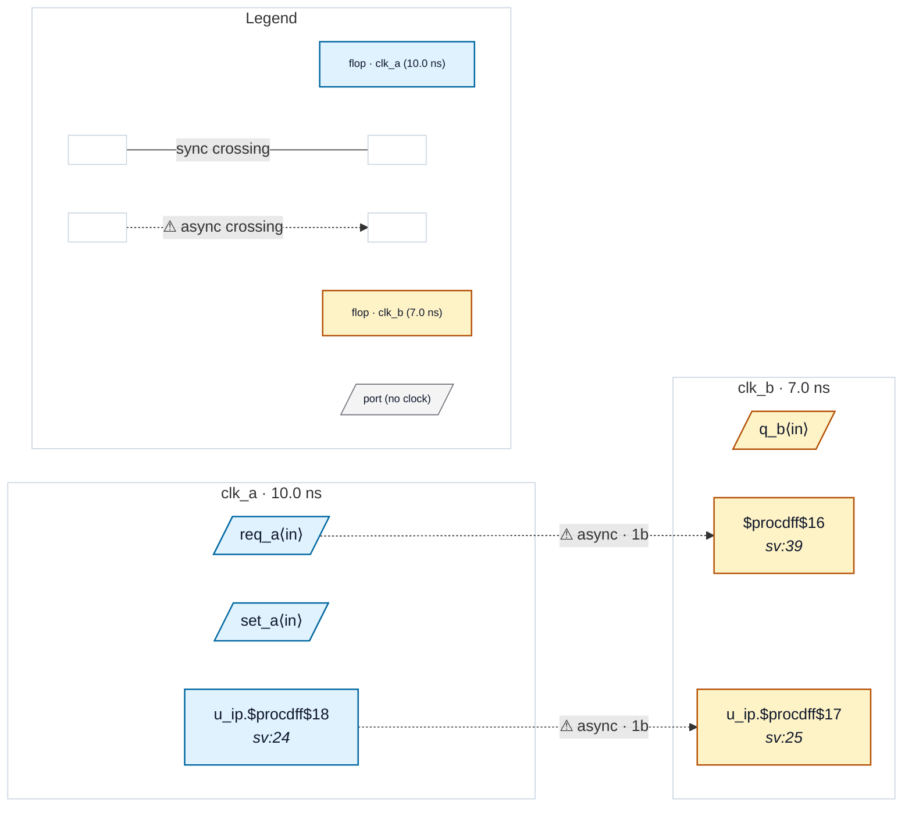

# Fixture: `bad_deep_comb_crossing`

<!-- generator: scripts/gen_fixture_docs.py -->

Crossings behind more than four combinational cells (rtl-buddy-cdc#347).

Two unsynchronised clk_a -> clk_b paths, each through a six-deep AND/OR chain qualified by clk_b-domain inputs: one from the clk_a input port `req_a`, one inside `deep_ip` from its clk_a register `flag_a`. The crossing walk used to stop after four cells, so neither was reported, with no diagnostic; it now walks the whole cone and CDC-001 fires on both destinations. `--crossing-depth 4` reproduces the old cut and reports it in `summary.crossing_depth_cut`.

`bad_deep_comb_crossing.grey.json` keeps `deep_ip` as a boundary cell with its body, so its internal path goes through the compositional pass (rtl-buddy-cdc#261) and a cut there is lifted.

- **Status:** negative — analyzer must report a violation
- **Top module:** `bad_deep_comb_crossing`
- **Clocks:** `clk_a` (10.0 ns), `clk_b` (7.0 ns)
- **Crossings:** 2 structural (2 async-per-SDC, 0 sync)

## Clock-domain map

## Files

- `bad_deep_comb_crossing.gates.json`
- `bad_deep_comb_crossing.grey.json`
- `bad_deep_comb_crossing.json`
- `bad_deep_comb_crossing.sdc`
- `bad_deep_comb_crossing.sv`

---
*Generated by `scripts/gen_fixture_docs.py` — re-run after editing the SV/SDC/netlist.*
