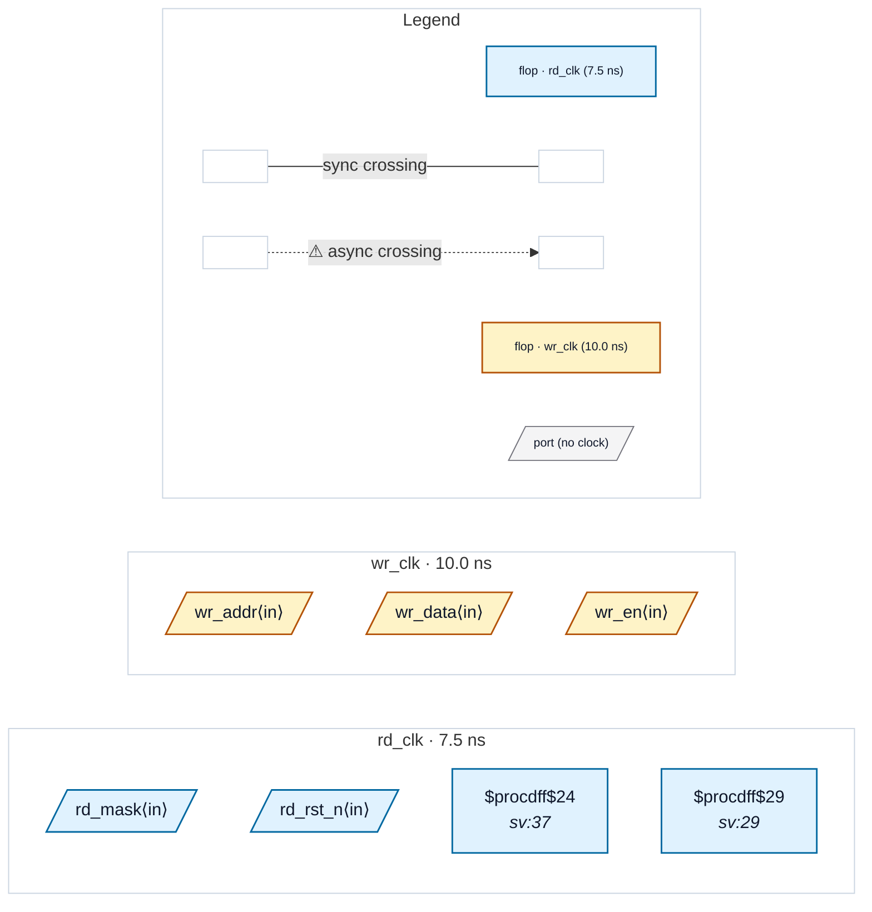

# Fixture: `bad_dualport_ram_async_read`

<!-- generator: scripts/gen_fixture_docs.py -->

Negative fixture for CDC-026 (issue #326): asynchronous-read variant.

The RAM is written on `wr_clk`. The read side reads it combinationally (`mem[rd_addr]`, an asynchronous read port) and folds the word through a little logic (`^ rd_mask`) before an `rd_clk` register captures it — so the write domain passes through the read port and the XOR straight into `rd_clk`. The read address is a free-running `rd_clk` counter with no pointer or flag synchronised from `wr_clk`, so CDC-026 must fire, with the read domain taken from the capturing register.

- **Status:** negative — analyzer must report a violation
- **Top module:** `bad_dualport_ram_async_read`
- **Clocks:** `rd_clk` (7.5 ns), `wr_clk` (10.0 ns)
- **Crossings:** 0 structural (0 async-per-SDC, 0 sync)
- **Memory crossings:** 1 write→read storage path(s) (1 async-per-SDC)

## Clock-domain map

## Files

- `bad_dualport_ram_async_read.json`
- `bad_dualport_ram_async_read.sdc`
- `bad_dualport_ram_async_read.sv`

---
*Generated by `scripts/gen_fixture_docs.py` — re-run after editing the SV/SDC/netlist.*
