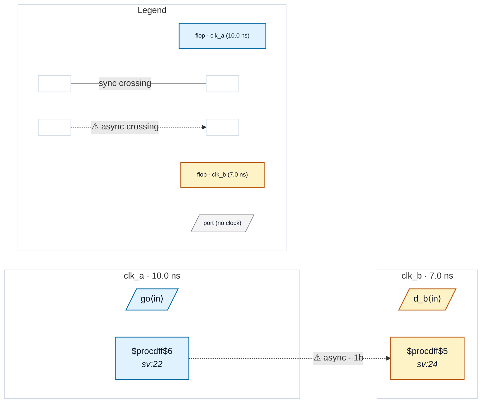

# Fixture: `bad_enable_pin_crossing`

<!-- generator: scripts/gen_fixture_docs.py -->

A clock-domain crossing that enters a flop only through its enable (rtl-buddy-cdc#375).

`en_a` is registered in `clk_a` and used, unsynchronised, as the load enable of `q` in `clk_b`. The data `d_b` is a `clk_b` input, so the only crossing is the enable: when `en_a` changes close to a `clk_b` edge, `q` can go metastable or load on the wrong cycle.

After `proc` the enable is a hold mux on `q`'s D; after `opt_dff` it is folded into a `$dffe` EN pin (`$_DFFE_*` E at gate level). The crossing, and CDC-001 on it, must be the same in all three forms.

- **Status:** negative — analyzer must report a violation
- **Top module:** `bad_enable_pin_crossing`
- **Clocks:** `clk_a` (10.0 ns), `clk_b` (7.0 ns)
- **Crossings:** 1 structural (1 async-per-SDC, 0 sync)

## Clock-domain map

## Files

- `bad_enable_pin_crossing.json`
- `bad_enable_pin_crossing.optdff.json`
- `bad_enable_pin_crossing.sdc`
- `bad_enable_pin_crossing.sv`
- `bad_enable_pin_crossing.synth.json`

---
*Generated by `scripts/gen_fixture_docs.py` — re-run after editing the SV/SDC/netlist.*
