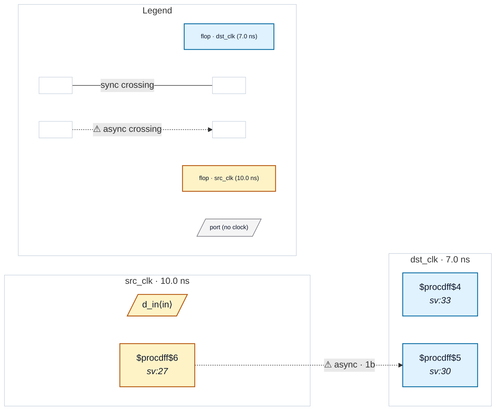

# Fixture: `bad_exported_sync_stage`

<!-- generator: scripts/gen_fixture_docs.py -->

Negative-case fixture: a one-flop "synchroniser" whose stage is exported straight to an output port and also pipelined. Should trip CDC-001.

`dst_meta` is the only destination flop that samples the crossing. Its possibly-metastable value leaves the design on `q_tap` with no logic in between, and also feeds `q_pipe`. The exported tap is a second reader of the first stage, so `dst_meta -> q_pipe` is not a two-stage synchroniser: the chain is one flop deep.

```text
       src_clk          dst_clk
  [ src_q ] ──────► [ dst_meta ] ──► [ q_pipe ] ──► q_pipe
                         └────────────────────────► q_tap  (direct)
Issue: rtl-buddy-cdc#344
```

- **Status:** negative — analyzer must report a violation
- **Top module:** `bad_exported_sync_stage`
- **Clocks:** `dst_clk` (7.0 ns), `src_clk` (10.0 ns)
- **Crossings:** 1 structural (1 async-per-SDC, 0 sync)

## Clock-domain map



## Files

- `bad_exported_sync_stage.json`
- `bad_exported_sync_stage.sdc`
- `bad_exported_sync_stage.sv`

---
*Generated by `scripts/gen_fixture_docs.py` — re-run after editing the SV/SDC/netlist.*
