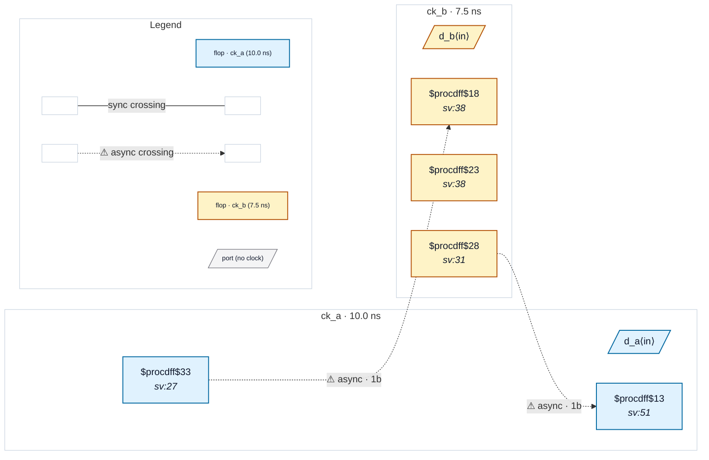

# Fixture: `bad_false_path_one_direction`

<!-- generator: scripts/gen_fixture_docs.py -->

Negative fixture: a clock-pair set_false_path written in one direction only, with the reverse crossing unsynchronised (rtl-buddy-cdc#331).

Same SDC as good_false_path_one_direction: only `set_false_path -from [get_clocks ck_a] -to [get_clocks ck_b]`. The clock pair is read as asynchronous in both directions, so the reverse crossing ck_b → ck_a, captured by a single flop, is checked like any other: CDC-001 fires exactly once (b_q → a_cap). Reading the false path as one-way would leave ck_b → ck_a timed and hide the missing synchroniser; the pairwise reading reports it. The written direction, ck_a → ck_b, keeps its 2FF synchroniser.

```text
  [a_q] ck_a ──2FF──▶ ck_b      (the false-path direction)
  [b_q] ck_b ──1FF──▶ ck_a      → CDC-001
```

- **Status:** negative — analyzer must report a violation
- **Top module:** `bad_false_path_one_direction`
- **Clocks:** `ck_a` (10.0 ns), `ck_b` (7.5 ns)
- **Crossings:** 2 structural (2 async-per-SDC, 0 sync)

## Clock-domain map



## Files

- `bad_false_path_one_direction.json`
- `bad_false_path_one_direction.sdc`
- `bad_false_path_one_direction.sv`

---
*Generated by `scripts/gen_fixture_docs.py` — re-run after editing the SV/SDC/netlist.*
