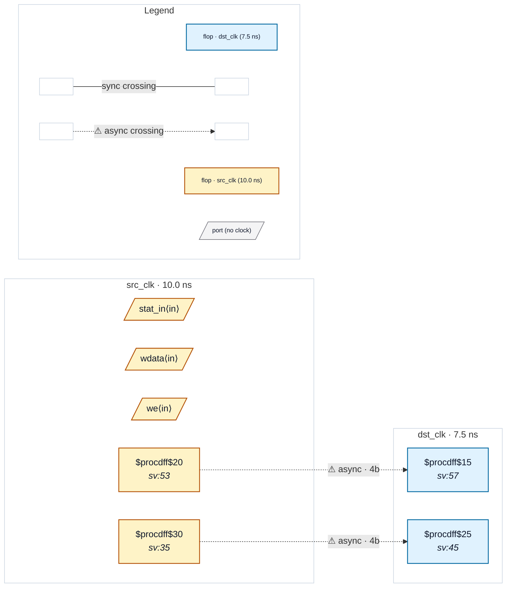

# Fixture: `bad_false_path_through_partial`

<!-- generator: scripts/gen_fixture_docs.py -->

Negative fixture: an object-scoped set_false_path -through that covers one bus crossing but not a second one (rtl-buddy-cdc#331).

Same as good_false_path_through_bus (cfg_q routed through u_bridge, `set_false_path -through [get_pins u_bridge/cfg_o]`), plus a second 4-bit src_clk register, stat_q, captured by its own single dst_clk register without passing u_bridge. A -through statement covers only the paths that pass its pin, so it acknowledges the cfg crossing (CDC-004 suppressed) and leaves the stat crossing alone: CDC-004 fires exactly once, on stat_q → stat_cap.

```text
  [cfg_q]  src_clk ─4b─▶ u_bridge/cfg_o ─4b─▶ [cfg_cap]   CDC-004 suppressed
  [stat_q] src_clk ─4b───────────────────▶ [stat_cap]  → CDC-004
```

- **Status:** negative — analyzer must report a violation
- **Top module:** `bad_false_path_through_partial`
- **Clocks:** `dst_clk` (7.5 ns), `src_clk` (10.0 ns)
- **Crossings:** 2 structural (2 async-per-SDC, 0 sync)

## Clock-domain map



## Files

- `bad_false_path_through_partial.json`
- `bad_false_path_through_partial.sdc`
- `bad_false_path_through_partial.sv`

---
*Generated by `scripts/gen_fixture_docs.py` — re-run after editing the SV/SDC/netlist.*
