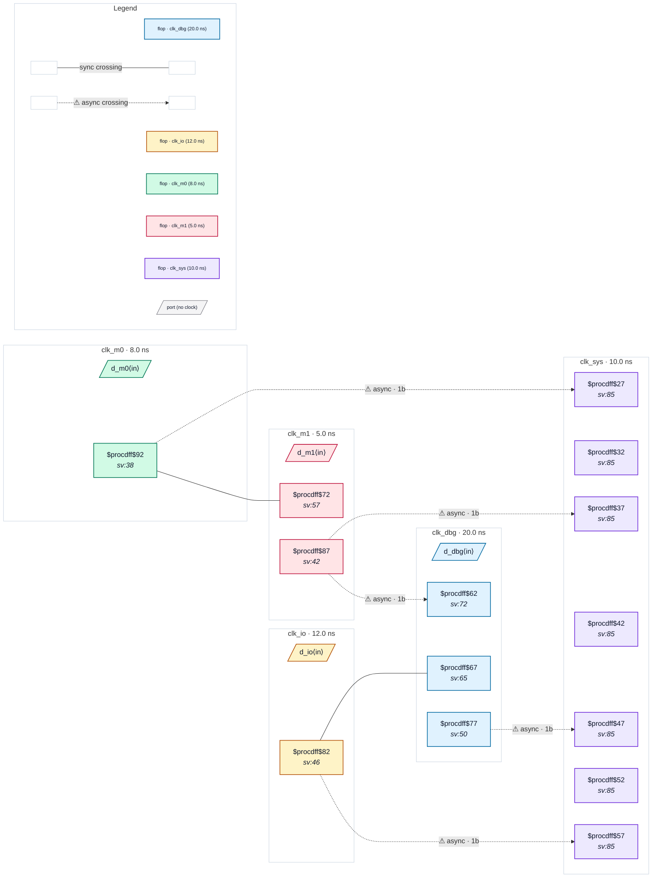

# Fixture: `bad_five_clock_exclusive`

<!-- generator: scripts/gen_fixture_docs.py -->

Negative fixture: five clocks mixing asynchronous and exclusive groups, with two reachable crossings left unsynchronised (rtl-buddy-cdc#331).

```text
Same clocks and SDC as good_five_clock_exclusive: all five clocks are
mutually asynchronous, clk_m0 / clk_m1 are -physically_exclusive and
clk_io / clk_dbg -logically_exclusive. The two raw captures between
members of one exclusive statement (clk_m0 → clk_m1,
clk_io → clk_dbg) stay unreachable and silent. Two reachable
crossings lose their synchroniser:
  clk_io → clk_sys   io_q captured by one flop → CDC-001
  clk_m1 → clk_dbg   m1_q captured by one flop → CDC-001: clk_m1 and
                     clk_dbg sit in different exclusive statements,
                     which never relate them, so the pair is live
Exactly two CDC-001 and nothing else.
```

```text
  clk_m0 ─raw─▶ clk_m1   (excl)      clk_io ─raw─▶ clk_dbg   (excl)
  io ──1FF──▶ clk_sys                 m1 ──1FF──▶ clk_dbg
```

- **Status:** negative — analyzer must report a violation
- **Top module:** `bad_five_clock_exclusive`
- **Clocks:** `clk_dbg` (20.0 ns), `clk_io` (12.0 ns), `clk_m0` (8.0 ns), `clk_m1` (5.0 ns), `clk_sys` (10.0 ns)
- **Crossings:** 7 structural (5 async-per-SDC, 2 sync)

## Clock-domain map



## Files

- `bad_five_clock_exclusive.json`
- `bad_five_clock_exclusive.sdc`
- `bad_five_clock_exclusive.sv`

---
*Generated by `scripts/gen_fixture_docs.py` — re-run after editing the SV/SDC/netlist.*
