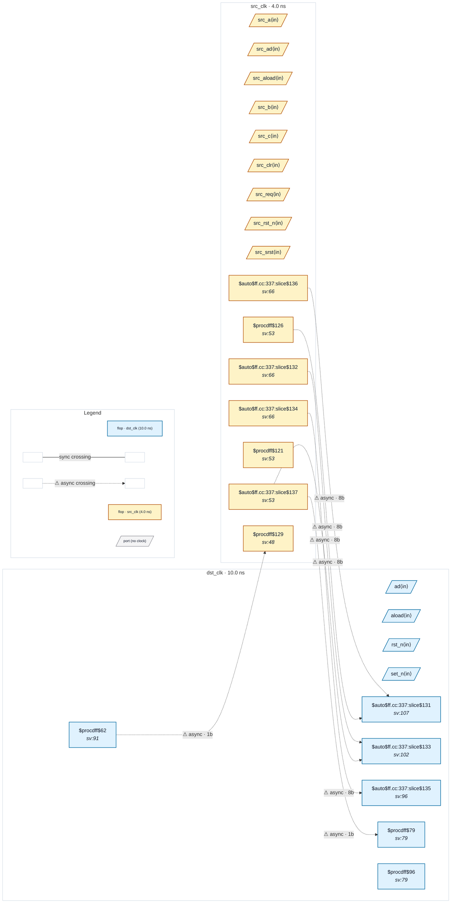

# Fixture: `bad_flop_variety_handshake`

<!-- generator: scripts/gen_fixture_docs.py -->

Flop-type coverage on a broken handshake (rtl-buddy-cdc#331).

good_flop_variety_handshake with four bugs, each on one of its flop families (netlist built with `opt_dff` after `proc`):

```text
  ack_sync  $aldff   one-stage ack synchroniser          CDC-001
  cap_b     $aldffe  loads on the unsynchronised req     CDC-004 x2
  cap_c     $sdffce  sync reset from a src_clk register  RDC-003, CDC-012
  cap_a     $dffsre  async clear from a src_clk register RDC-001
```

cap_b's two CDC-004s are the payload bus and the 1-bit request, which fans out to all eight enable lanes. cap_c's reset register is loaded under the synchronised enable, but nothing holds it stable: CDC-012 reports from the data side what RDC-003 reports from the reset side. req_s1 / req_s2 (`$dffsr`) are still a correct request synchroniser.

cap_a's CLR is the mux `clr_q ? 1 : 0` that proc builds on a set / clear flop: a buffer of the register, not combinational logic, so RDC-001 reports the foreign clear and RDC-004 stays silent (rtl-buddy-cdc#383). The gate-level and slang verdicts differ for other reasons (see the gate-level allowlist and tests/test_cell_variety_fixtures.py).

- **Status:** negative — analyzer must report a violation
- **Top module:** `bad_flop_variety_handshake`
- **Clocks:** `dst_clk` (10.0 ns), `src_clk` (4.0 ns)
- **Crossings:** 7 structural (7 async-per-SDC, 0 sync)

## Clock-domain map



## Files

- `bad_flop_variety_handshake.json`
- `bad_flop_variety_handshake.sdc`
- `bad_flop_variety_handshake.sv`

---
*Generated by `scripts/gen_fixture_docs.py` — re-run after editing the SV/SDC/netlist.*
