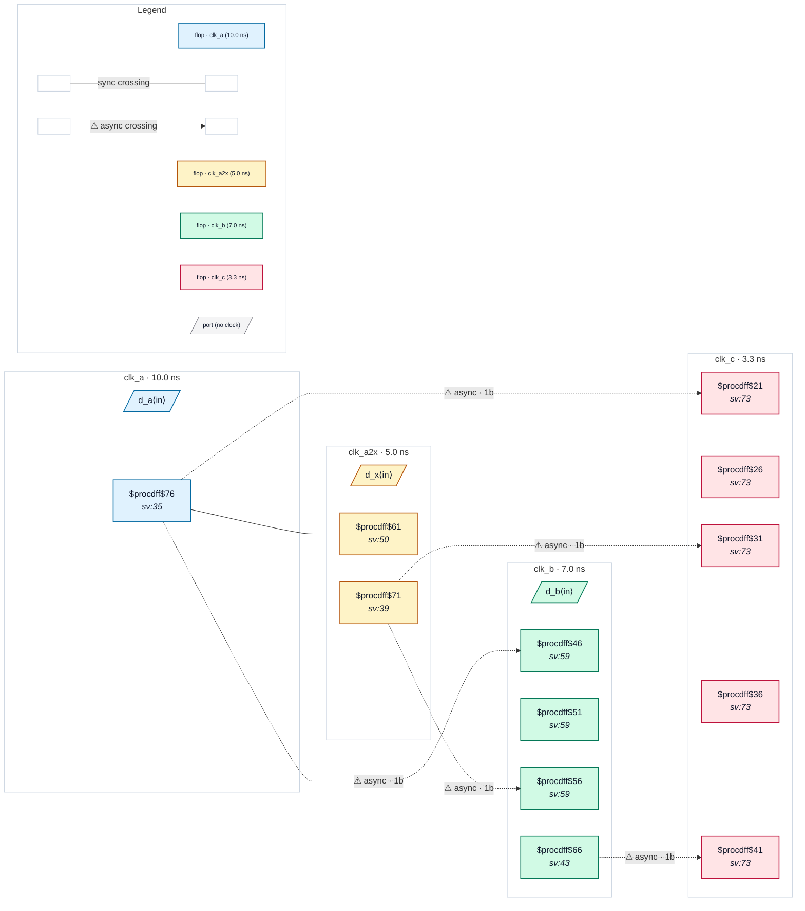

# Fixture: `bad_four_clock_mixed`

<!-- generator: scripts/gen_fixture_docs.py -->

Negative fixture: four clocks, two synchronous and two asynchronous, with two of the five async crossings unsynchronised (rtl-buddy-cdc#331).

```text
Same clocks and SDC as good_four_clock_mixed: clk_a2x is a
-multiply_by 2 generated clock of clk_a, both in the first group of
one set_clock_groups -asynchronous, clk_b and clk_c in groups of
their own. Two hops lose their second stage:
  clk_a2x → clk_b  x_q captured by one flop → CDC-001 (the group
                   puts clk_a2x itself, not just its master, async)
  clk_b   → clk_c  b_q captured by one flop → CDC-001
The raw clk_a → clk_a2x register stays silent (same root, timed by
STA), and the other three crossings keep their 2FF synchronisers.
Exactly two CDC-001 and nothing else.
```

```text
  group 1: clk_a, clk_a2x (×2)   group 2: clk_b   group 3: clk_c
  [a_q]──raw──▶[x_cap]   x_q ──1FF──▶ clk_b   b_q ──1FF──▶ clk_c
```

- **Status:** negative — analyzer must report a violation
- **Top module:** `bad_four_clock_mixed`
- **Clocks:** `clk_a` (10.0 ns), `clk_a2x` (5.0 ns), `clk_b` (7.0 ns), `clk_c` (3.3 ns)
- **Crossings:** 6 structural (5 async-per-SDC, 1 sync)

## Clock-domain map



## Files

- `bad_four_clock_mixed.json`
- `bad_four_clock_mixed.sdc`
- `bad_four_clock_mixed.sv`

---
*Generated by `scripts/gen_fixture_docs.py` — re-run after editing the SV/SDC/netlist.*
