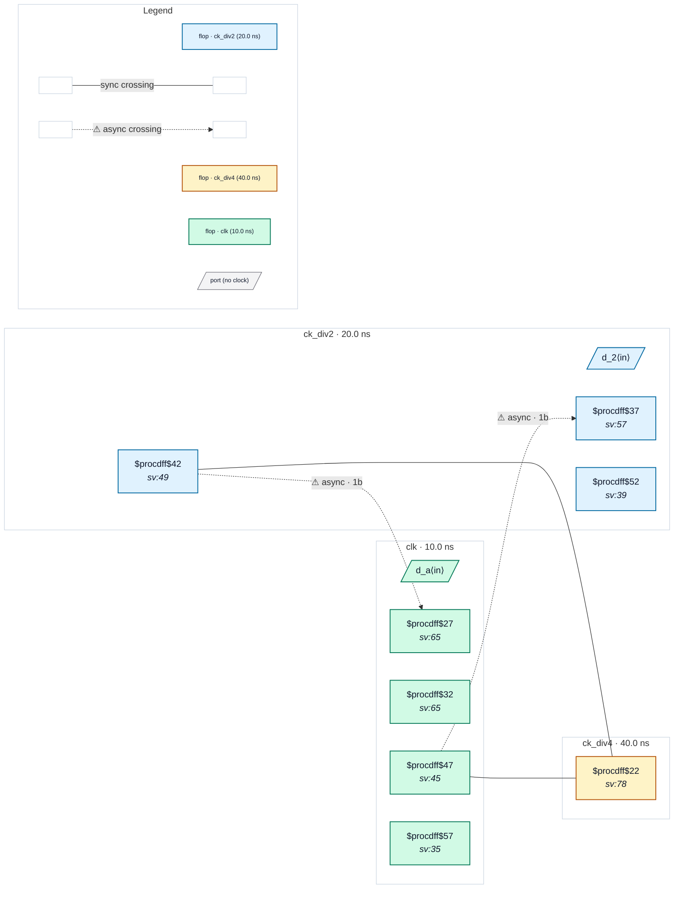

# Fixture: `bad_gen_clock_async_to_master`

<!-- generator: scripts/gen_fixture_docs.py -->

Negative fixture: a generated clock declared asynchronous to its own master (rtl-buddy-cdc#331).

```text
clk drives a divide-by-2 toggle flop declared ck_div2, and ck_div2 a
second one declared ck_div4 (master ck_div2). The SDC overrides the
generated relationship for ck_div2 only:
set_clock_groups -asynchronous -group {clk} -group {ck_div2}. An
explicit group on the clock names wins over the generated-to-master
collapse, so:
  clk → ck_div2    raw single flop → CDC-001
  ck_div2 → clk    2FF synchroniser, async but clean
The override covers the named clocks only, as set_clock_groups does
for STA (a generated clock is not swept into its master's or its
parent's group unless listed). ck_div4 is unnamed, so it collapses to
its root clk: the raw clk → ck_div4 and ck_div2 → ck_div4 paths are
synchronous and silent. Exactly one CDC-001.
```

```text
  clk ─▶ [div2_q] = ck_div2 (async to clk by SDC) ─▶ [div4_q] = ck_div4
  [a_q] (clk) ──1FF──▶ [d2_cap] (ck_div2)          → CDC-001
  [d2_q] (ck_div2) ──2FF──▶ clk                    async, synced
  [a_q], [d2_q] ──raw──▶ [d4_cap] (ck_div4)        synchronous
```

- **Status:** negative — analyzer must report a violation
- **Top module:** `bad_gen_clock_async_to_master`
- **Clocks:** `ck_div2` (20.0 ns), `ck_div4` (40.0 ns), `clk` (10.0 ns)
- **Crossings:** 4 structural (2 async-per-SDC, 2 sync)

## Clock-domain map



## Files

- `bad_gen_clock_async_to_master.json`
- `bad_gen_clock_async_to_master.sdc`
- `bad_gen_clock_async_to_master.sv`

---
*Generated by `scripts/gen_fixture_docs.py` — re-run after editing the SV/SDC/netlist.*
