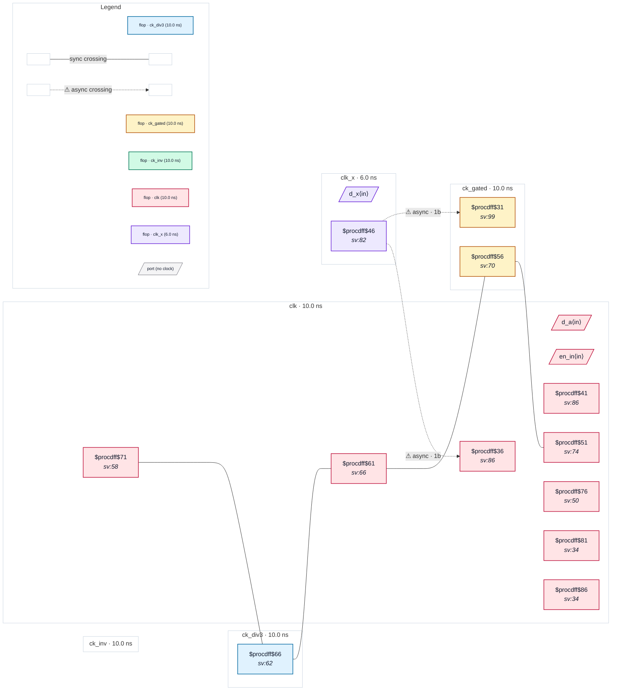

# Fixture: `bad_gen_clock_edges_invert`

<!-- generator: scripts/gen_fixture_docs.py -->

Negative fixture: an asynchronous clock captured by one flop in a -combinational generated clock domain (rtl-buddy-cdc#331).

Same clocks and SDC as good_gen_clock_edges_invert: ck_div3 (-edges {1 3 7}), ck_inv (-invert) and ck_gated (-combinational) are all generated from clk on internal pins, and clk_x is asynchronous to clk through a group that names the root only. The raw chain among the clk-derived clocks is still synchronous and silent. clk_x now also feeds a single ck_gated flop: ck_gated collapses to clk, which the group separates from clk_x, so the crossing is asynchronous and CDC-001 fires exactly once (x_q → gx_q). The 2FF synchroniser into clk stays clean.

```text
  [a_q] clk ─raw─▶ [d3_q] ck_div3 ─raw─▶ [inv_q] ck_inv
    ─raw─▶ [g_q] ck_gated ─raw─▶ [back_q] clk          synchronous
  [x_q] clk_x ──2FF──▶ clk
  [x_q] clk_x ──1FF──▶ [gx_q] ck_gated                 → CDC-001
```

- **Status:** negative — analyzer must report a violation
- **Top module:** `bad_gen_clock_edges_invert`
- **Clocks:** `ck_div3` (10.0 ns), `ck_gated` (10.0 ns), `ck_inv` (10.0 ns), `clk` (10.0 ns), `clk_x` (6.0 ns)
- **Crossings:** 6 structural (2 async-per-SDC, 4 sync)

## Clock-domain map



## Files

- `bad_gen_clock_edges_invert.json`
- `bad_gen_clock_edges_invert.sdc`
- `bad_gen_clock_edges_invert.sv`

---
*Generated by `scripts/gen_fixture_docs.py` — re-run after editing the SV/SDC/netlist.*
