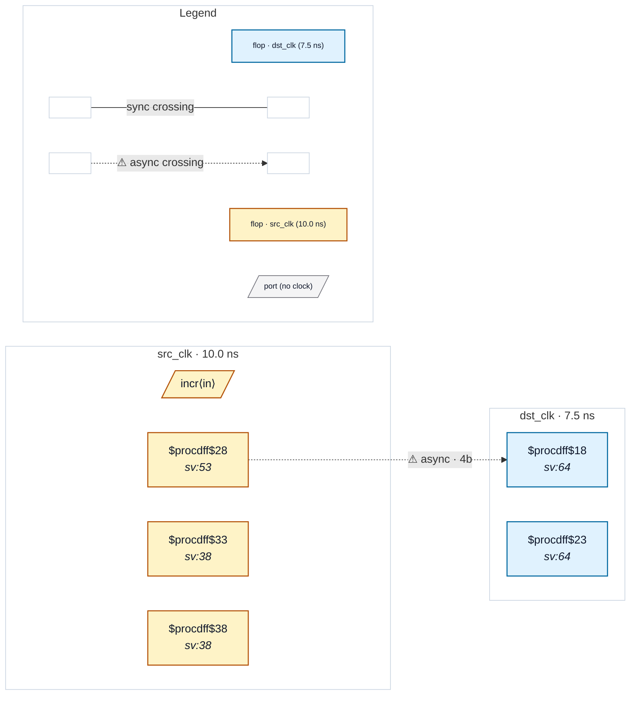

# Fixture: `bad_gray_phase_break`

<!-- generator: scripts/gen_fixture_docs.py -->

Conservative CDC-004 on a gray code re-registered before the crossing (issue #174; header corrected in rtl-buddy-cdc#378).

`gray2_q` is a plain one-cycle delay of the gray counter `gray_q` in the same clock. A register only changes on its clock edge, and consecutive values of a delayed gray sequence still differ in one bit, so the re-register adds latency and nothing else: the crossing is as safe as sampling `gray_q` directly.

CDC-004 fires anyway. The structural gray detector walks back from the crossing flop's `D`, stops at the first flop boundary (`gray_q`'s Q), and never sees the `b ^ (b >> 1)` XOR shape. That is a known false positive, kept on purpose: the detector does not prove the intermediate register is an unconditional delay, and a load-enabled copy, which can skip codes, stops the walk the same way. `(* cdc_gray *)` on `gray2_q` is the escape hatch.

This fixture pins that conservative verdict: a change that walks across the intermediate flop has to prove it is a pure delay, and then moves this fixture to the `good_` side.

- **Status:** negative — analyzer must report a violation
- **Top module:** `bad_gray_phase_break`
- **Clocks:** `dst_clk` (7.5 ns), `src_clk` (10.0 ns)
- **Crossings:** 1 structural (1 async-per-SDC, 0 sync)

## Clock-domain map

## Files

- `bad_gray_phase_break.json`
- `bad_gray_phase_break.sdc`
- `bad_gray_phase_break.sv`

---
*Generated by `scripts/gen_fixture_docs.py` — re-run after editing the SV/SDC/netlist.*
