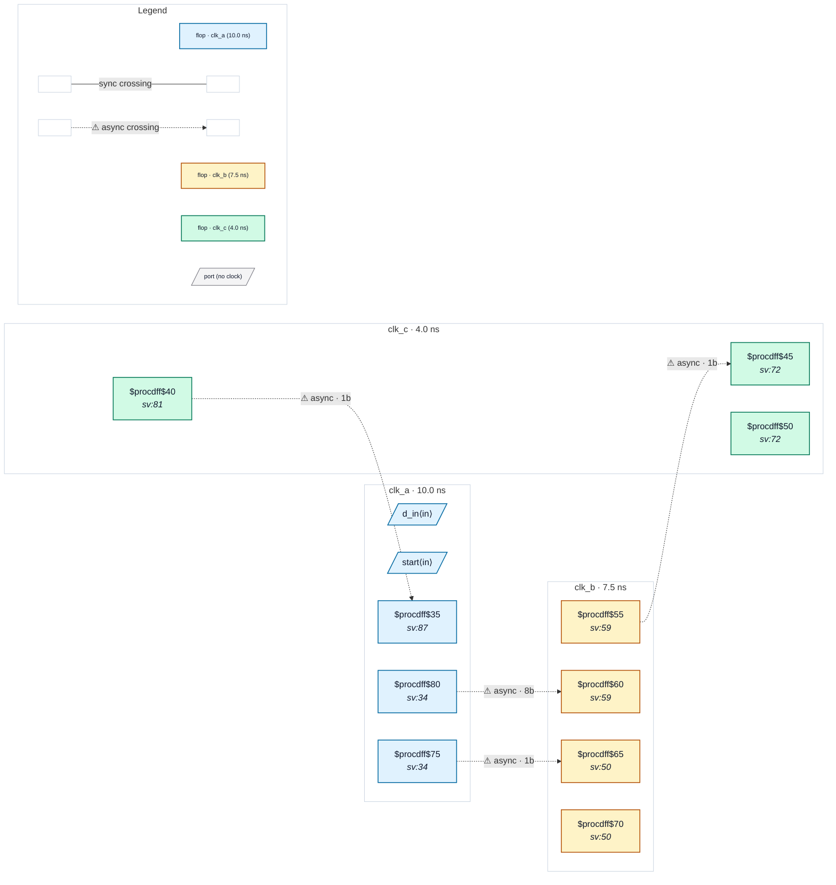

# Fixture: `bad_handshake_ack_via_third_domain`

<!-- generator: scripts/gen_fixture_docs.py -->

Negative fixture: a req/ack bus handshake whose acknowledge returns through a third clock domain, with the last hop unsynchronised (rtl-buddy-cdc#331).

Same three asynchronous clocks and structure as good_handshake_ack_via_third_domain: clk_a launches a held 8-bit payload and a level request, clk_b synchronises the request and loads the payload through a mux on that synchronised request, and clk_b's acknowledge is relayed through clk_c (2FF in, re-registered) back to clk_a. The clk_c → clk_a hop is captured by a single flop, a_ack_s1, which clk_a then uses to release the request: CDC-001 fires exactly once, on c_ack_q → a_ack_s1. The payload is still held until the (relayed) acknowledge, so CDC-012 must stay silent, and the gated payload is not a CDC-004.

```text
  clk_a [req_q, data_q] ──req 2FF──▶ clk_b [b_data ◀ mux(data_q)]
       ▲                                   │ b_ack_q
       └──1FF── clk_c [c_ack_q] ◀──2FF─────┘   → CDC-001 (C → A)
```

- **Status:** negative — analyzer must report a violation
- **Top module:** `bad_handshake_ack_via_third_domain`
- **Clocks:** `clk_a` (10.0 ns), `clk_b` (7.5 ns), `clk_c` (4.0 ns)
- **Crossings:** 4 structural (4 async-per-SDC, 0 sync)

## Clock-domain map



## Files

- `bad_handshake_ack_via_third_domain.json`
- `bad_handshake_ack_via_third_domain.sdc`
- `bad_handshake_ack_via_third_domain.sv`

---
*Generated by `scripts/gen_fixture_docs.py` — re-run after editing the SV/SDC/netlist.*
