# Fixture: `bad_handshake_single_bit`

<!-- generator: scripts/gen_fixture_docs.py -->

Single-bit captures that are NOT qualified by a handshake (rtl-buddy-cdc#368).

CDC-001 accepts a 1-bit crossing captured under an enable synchronised from its own source domain, from a source held until a synced-back acknowledge returns (`good_handshake_single_bit`). Each capture here breaks exactly one of those conditions and must still fire CDC-001:

```text
- `f_free`: enable from a free-running dst_clk counter.
- `f_unsync`: enable from a single-flop capture of the request toggle
  (`u1` is read twice, so it is no synchroniser; `u1` fires too).
- `f_third`: enable from a toggle synchronised from a third clock.
- `f_dsel`: a mux that picks between two held source bits on the
  synchronised edge and otherwise samples the other: no hold.
- `f_open`: correct synchronised enable, but the source reloads on
  every `load` with no acknowledge (open loop). Its 8-bit sibling
  `d_open` is CDC-012's (warning); the 1-bit capture stays CDC-001.
```

The first four share one closed-loop handshake (`tog_a`, ack `a1`/`a2`), so only the named condition differs from the good shape.

- **Status:** negative — analyzer must report a violation
- **Top module:** `bad_handshake_single_bit`
- **Clocks:** `dst_clk` (10.0 ns), `oth_clk` (7.0 ns), `src_clk` (4.0 ns)
- **Crossings:** 12 structural (12 async-per-SDC, 0 sync)

## Clock-domain map

```mermaid
%% bad_handshake_single_bit — generated by rtl-buddy-cdc render
flowchart LR
  subgraph clk_dst_clk["dst_clk · 10.0 ns"]
    direction TB
    f_a3915302["$procdff$56<br/><i>sv:105</i>"]:::ckcls_dst_clk
    f_2a4cc28b["$procdff$57<br/><i>sv:105</i>"]:::ckcls_dst_clk
    f_44af0c22["$procdff$58<br/><i>sv:105</i>"]:::ckcls_dst_clk
    f_eeaae0e4["$procdff$59<br/><i>sv:105</i>"]:::ckcls_dst_clk
    f_04476f49["$procdff$60<br/><i>sv:105</i>"]:::ckcls_dst_clk
    f_30b5a0f2["$procdff$64<br/><i>sv:91</i>"]:::ckcls_dst_clk
    f_49d9f614["$procdff$65<br/><i>sv:83</i>"]:::ckcls_dst_clk
    f_2ff19262["$procdff$66<br/><i>sv:83</i>"]:::ckcls_dst_clk
    f_8f48b5c8["$procdff$67<br/><i>sv:83</i>"]:::ckcls_dst_clk
    f_d53ef873["$procdff$68<br/><i>sv:83</i>"]:::ckcls_dst_clk
    f_055df3e2["$procdff$70<br/><i>sv:73</i>"]:::ckcls_dst_clk
    f_28c9989a["$procdff$71<br/><i>sv:73</i>"]:::ckcls_dst_clk
    f_1f0f5d43["$procdff$72<br/><i>sv:73</i>"]:::ckcls_dst_clk
    f_ab2ab842["$procdff$73<br/><i>sv:66</i>"]:::ckcls_dst_clk
    f_e6961caf["$procdff$74<br/><i>sv:66</i>"]:::ckcls_dst_clk
    f_ae9f388f["$procdff$75<br/><i>sv:58</i>"]:::ckcls_dst_clk
    f_00b95f2b["$procdff$76<br/><i>sv:58</i>"]:::ckcls_dst_clk
    f_4e395541["$procdff$77<br/><i>sv:58</i>"]:::ckcls_dst_clk
  end
  subgraph clk_oth_clk["oth_clk · 7.0 ns"]
    direction TB
    f_2f006d6a["$procdff$69<br/><i>sv:81</i>"]:::ckcls_oth_clk
  end
  subgraph clk_src_clk["src_clk · 4.0 ns"]
    direction TB
    p_in_data_in[/"data_in⟨in⟩"/]:::ckcls_src_clk
    p_in_en_in[/"en_in⟨in⟩"/]:::ckcls_src_clk
    p_in_flag_in[/"flag_in⟨in⟩"/]:::ckcls_src_clk
    p_in_load[/"load⟨in⟩"/]:::ckcls_src_clk
    f_88581b5f["$procdff$61<br/><i>sv:98</i>"]:::ckcls_src_clk
    f_61fb45ad["$procdff$62<br/><i>sv:98</i>"]:::ckcls_src_clk
    f_e174fe3f["$procdff$63<br/><i>sv:98</i>"]:::ckcls_src_clk
    f_42654972["$procdff$78<br/><i>sv:43</i>"]:::ckcls_src_clk
    f_f2106ddf["$procdff$79<br/><i>sv:43</i>"]:::ckcls_src_clk
    f_2ca0ec3d["$procdff$80<br/><i>sv:43</i>"]:::ckcls_src_clk
    f_68698cf8["$procdff$81<br/><i>sv:43</i>"]:::ckcls_src_clk
    f_54a2e8c7["$procdff$82<br/><i>sv:43</i>"]:::ckcls_src_clk
    f_eecc2038["$procdff$83<br/><i>sv:43</i>"]:::ckcls_src_clk
    f_b78284a5["$procdff$84<br/><i>sv:43</i>"]:::ckcls_src_clk
    f_4edab5e8["$procdff$85<br/><i>sv:43</i>"]:::ckcls_src_clk
  end
  f_88581b5f -. "⚠ async · 1b" .-> f_44af0c22
  f_61fb45ad -. "⚠ async · 1b" .-> f_a3915302
  f_e174fe3f -. "⚠ async · 8b" .-> f_2a4cc28b
  f_2f006d6a -. "⚠ async · 1b" .-> f_2ff19262
  f_4e395541 -. "⚠ async · 1b" .-> f_f2106ddf
  f_42654972 -. "⚠ async · 1b" .-> f_28c9989a
  f_42654972 -. "⚠ async · 1b" .-> f_ae9f388f
  f_68698cf8 -. "⚠ async · 1b" .-> f_ab2ab842
  f_54a2e8c7 -. "⚠ async · 1b" .-> f_055df3e2
  f_eecc2038 -. "⚠ async · 1b" .-> f_49d9f614
  f_b78284a5 -. "⚠ async · 1b" .-> f_30b5a0f2
  f_4edab5e8 -. "⚠ async · 1b" .-> f_30b5a0f2
  subgraph rb_legend["Legend"]
    direction LR
    lg_clk_dst_clk["flop · dst_clk (10.0 ns)"]:::ckcls_dst_clk
    lg_clk_oth_clk["flop · oth_clk (7.0 ns)"]:::ckcls_oth_clk
    lg_clk_src_clk["flop · src_clk (4.0 ns)"]:::ckcls_src_clk
    lg_port[/"port (no clock)"/]:::port_unassigned
    lg_sync_a[" "]:::ckcls_legend_neutral
    lg_sync_b[" "]:::ckcls_legend_neutral
    lg_async_a[" "]:::ckcls_legend_neutral
    lg_async_b[" "]:::ckcls_legend_neutral
    lg_sync_a --- |"sync crossing"| lg_sync_b
    lg_async_a -. "⚠ async crossing" .-> lg_async_b
  end
  style clk_dst_clk fill:none,stroke:#cbd5e1
  style clk_oth_clk fill:none,stroke:#cbd5e1
  style clk_src_clk fill:none,stroke:#cbd5e1
  style rb_legend fill:none,stroke:#cbd5e1
  style lg_clk_dst_clk font-size:11px
  style lg_clk_oth_clk font-size:11px
  style lg_clk_src_clk font-size:11px
  style lg_port font-size:11px
  style lg_sync_a font-size:11px
  style lg_sync_b font-size:11px
  style lg_async_a font-size:11px
  style lg_async_b font-size:11px
  classDef ckcls_dst_clk fill:#e0f2fe,stroke:#0369a1,stroke-width:1.5px,color:#0f172a
  classDef ckcls_oth_clk fill:#fef3c7,stroke:#b45309,stroke-width:1.5px,color:#0f172a
  classDef ckcls_src_clk fill:#d1fae5,stroke:#047857,stroke-width:1.5px,color:#0f172a
  classDef port_unassigned fill:#f4f4f5,stroke:#71717a,color:#0f172a
  classDef ckcls_legend_neutral fill:#ffffff,stroke:#cbd5e1,stroke-width:1px,color:#0f172a
```



## Files

- `bad_handshake_single_bit.json`
- `bad_handshake_single_bit.optdff.json`
- `bad_handshake_single_bit.sdc`
- `bad_handshake_single_bit.sv`

---
*Generated by `scripts/gen_fixture_docs.py` — re-run after editing the SV/SDC/netlist.*
