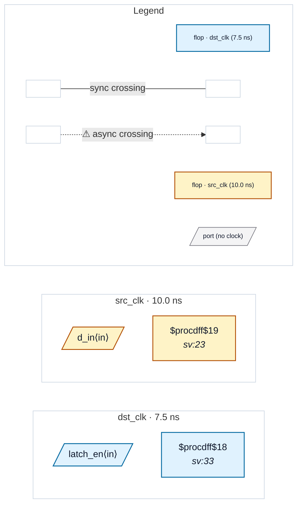

# Fixture: `bad_latch_in_cdc_path`

<!-- generator: scripts/gen_fixture_docs.py -->

Negative fixture for CDC-017 — transparent latch in CDC path.

A designer who tried to build a synchroniser out of a $dlatch + flop pair. During the latch's enable-active phase, the foreign domain src_q value propagates transparently through the latch to the dst-clock flop's D pin — no metastability resolution at all.

find_crossings doesn't traverse latches (it keys off flop-flop fanin), so without CDC-017 the entire bug is silent: zero crossings, zero findings on a real CDC failure. This fixture is the structural proof that the rule catches what the crossing walker can't see.

- **Status:** negative — analyzer must report a violation
- **Top module:** `bad_latch_in_cdc_path`
- **Clocks:** `dst_clk` (7.5 ns), `src_clk` (10.0 ns)
- **Crossings:** 0 structural (0 async-per-SDC, 0 sync)

## Clock-domain map

## Files

- `bad_latch_in_cdc_path.gates.json`
- `bad_latch_in_cdc_path.json`
- `bad_latch_in_cdc_path.sdc`
- `bad_latch_in_cdc_path.sv`

---
*Generated by `scripts/gen_fixture_docs.py` — re-run after editing the SV/SDC/netlist.*
