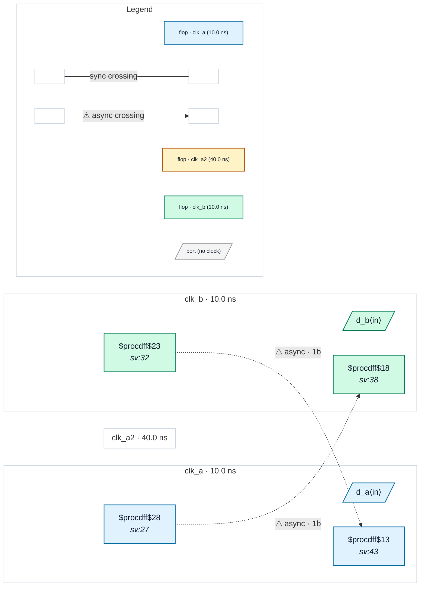

# Fixture: `bad_multi_clock_port`

<!-- generator: scripts/gen_fixture_docs.py -->

Negative fixture for a port carrying two clocks (create_clock -add).

Port clk_a carries two clocks: clk_a (functional mode, synchronous to clk_b) and clk_a2 (a second mode added with -add, asynchronous to clk_b). The two modes are physically exclusive. A raw flop→flop wire crosses clk_a → clk_b and another clk_b → clk_a, each with a single capture flop. In clk_a2 mode both are asynchronous crossings, so CDC-001 must fire on both, naming clk_a2 (rtl-buddy-cdc#330).

```text
     clk_a (+clk_a2)          clk_b
  ┌──[ a_q ]────────────────[ b_cap ]
  └──[ a_cap ]──────────────[ b_q ]──┘
  single capture flop each way → CDC-001 ×2
```

- **Status:** negative — analyzer must report a violation
- **Top module:** `bad_multi_clock_port`
- **Clocks:** `clk_a` (10.0 ns), `clk_a2` (40.0 ns), `clk_b` (10.0 ns)
- **Crossings:** 2 structural (2 async-per-SDC, 0 sync)

## Clock-domain map



## Files

- `bad_multi_clock_port.json`
- `bad_multi_clock_port.sdc`
- `bad_multi_clock_port.sv`

---
*Generated by `scripts/gen_fixture_docs.py` — re-run after editing the SV/SDC/netlist.*
