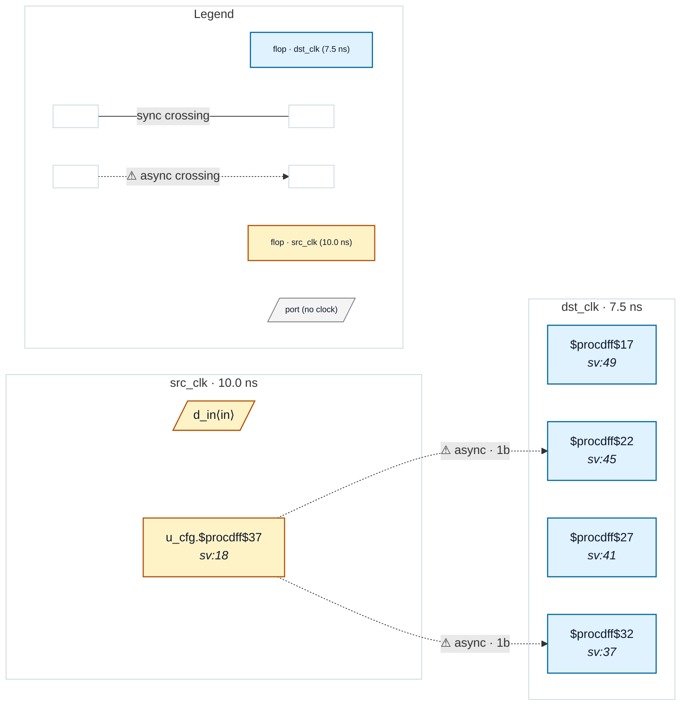

# Fixture: `bad_object_false_path_reconvergent`

<!-- generator: scripts/gen_fixture_docs.py -->

Negative fixture: an object-scoped false path does not hide reconvergence (#328).

A static configuration bit in u_cfg fans out to two independent 2FF synchronizer chains in dst_clk whose outputs recombine. The SDC false-paths the source register, which acknowledges the missing-synchroniser class of findings, but CDC-005 is a hazard of the destination's recombination, not of the source toggling, so it must still fire (the same choice (* cdc_static *) makes).

- **Status:** negative — analyzer must report a violation
- **Top module:** `bad_object_false_path_reconvergent`
- **Clocks:** `dst_clk` (7.5 ns), `src_clk` (10.0 ns)
- **Crossings:** 2 structural (2 async-per-SDC, 0 sync)

## Clock-domain map

## Files

- `bad_object_false_path_reconvergent.json`
- `bad_object_false_path_reconvergent.sdc`
- `bad_object_false_path_reconvergent.sv`

---
*Generated by `scripts/gen_fixture_docs.py` — re-run after editing the SV/SDC/netlist.*
