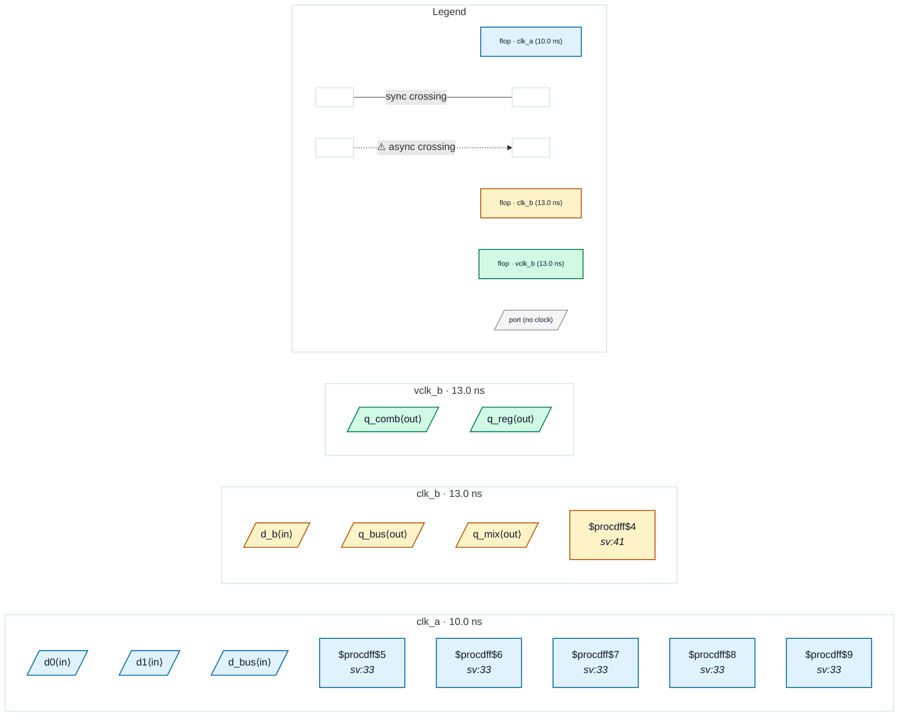

# Fixture: `bad_output_async_contract`

<!-- generator: scripts/gen_fixture_docs.py -->

Negative fixture for CDC-024 (issue #323): top-level outputs launched in clk_a whose set_output_delay contract names a receiving clock the SDC declares asynchronous to clk_a. The capture happens outside the design, so no internal flop receives these outputs and, before CDC-024, no crossing or finding existed at all.

One output per cone shape: q_reg is a directly registered output, q_comb a combinational cone of two clk_a flops (both contracted to the virtual clock vclk_b), q_bus a 4-bit registered vector, and q_mix a 4-bit vector whose upper two bits come from clk_a and lower two from clk_b (both contracted to clk_b, so only the clk_a half is async). CDC-024 must fire exactly once per output port, and nothing else may fire.

- **Status:** negative — analyzer must report a violation
- **Top module:** `bad_output_async_contract`
- **Clocks:** `clk_a` (10.0 ns), `clk_b` (13.0 ns), `vclk_b` (13.0 ns)
- **Crossings:** 0 structural (0 async-per-SDC, 0 sync)

## Clock-domain map

## Files

- `bad_output_async_contract.json`
- `bad_output_async_contract.sdc`
- `bad_output_async_contract.sv`

---
*Generated by `scripts/gen_fixture_docs.py` — re-run after editing the SV/SDC/netlist.*
