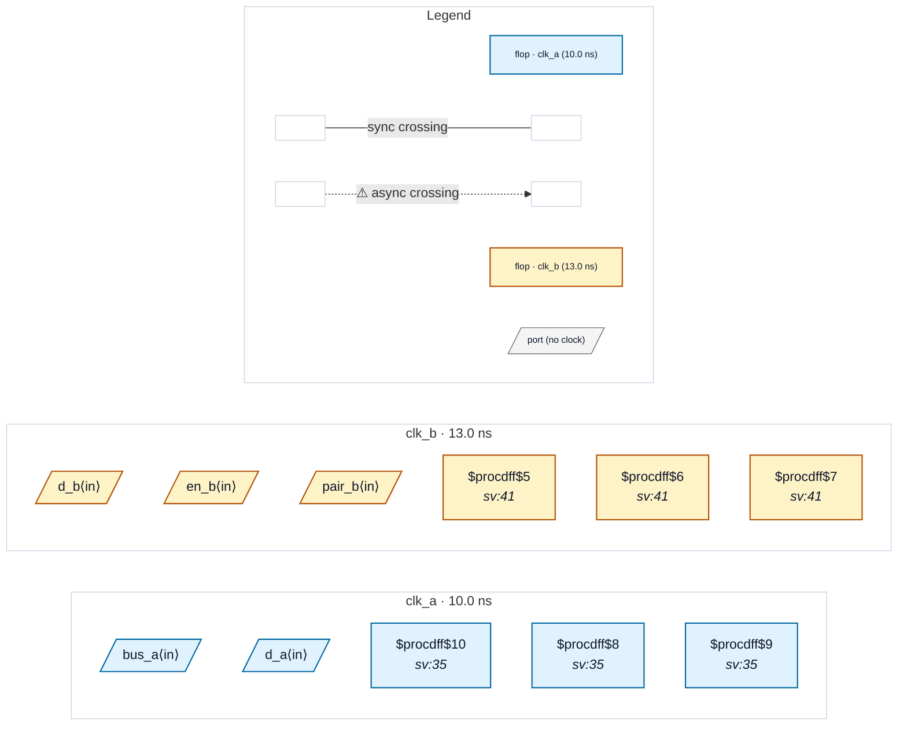

# Fixture: `bad_output_async_merge`

<!-- generator: scripts/gen_fixture_docs.py -->

Negative fixture for CDC-025 (issue #329): top-level outputs that combinationally merge launches from two clock domains the SDC declares asynchronous. No output carries a set_output_delay contract, but a boundary signal mixing asynchronous domains has no single clock any receiver can capture it on, so no constraint could make it correct.

irq ORs a clk_a flag with a clk_b flag. status gates a clk_a bus with a clk_b enable, so all four bits merge both domains. Two controls must stay silent: mixed concatenates a clk_a pair with a clk_b pair (no bit merges them), and q_a is a plain clk_a register. Outputs launched in a single domain are only reported once the SDC types some output, and this one types none. CDC-025 must fire as an error once on irq and once on status, and nothing else may fire.

- **Status:** negative — analyzer must report a violation
- **Top module:** `bad_output_async_merge`
- **Clocks:** `clk_a` (10.0 ns), `clk_b` (13.0 ns)
- **Crossings:** 0 structural (0 async-per-SDC, 0 sync)

## Clock-domain map

## Files

- `bad_output_async_merge.json`
- `bad_output_async_merge.sdc`
- `bad_output_async_merge.sv`

---
*Generated by `scripts/gen_fixture_docs.py` — re-run after editing the SV/SDC/netlist.*
