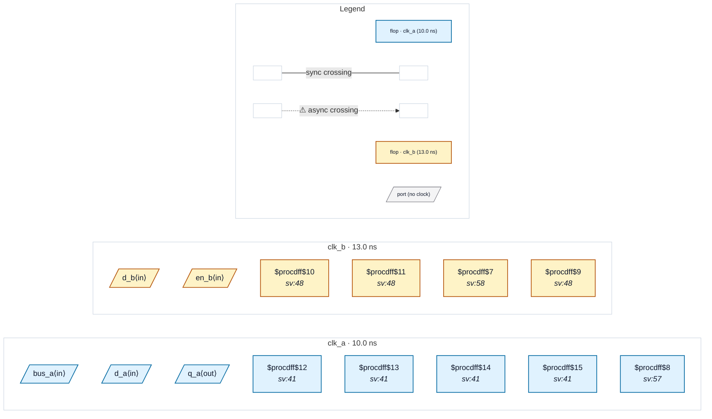

# Fixture: `bad_output_missing_contract`

<!-- generator: scripts/gen_fixture_docs.py -->

Negative fixture for CDC-025 (issue #329): an SDC that types some top-level outputs with set_output_delay -clock but misses others. Once the user has started typing outputs, a data output launched from clocked logic with no contract is likely an omission, so CDC-025 warns on it, naming its launch domain.

q_a is contracted and stays silent. q_b (a clk_b register), q_bus (a 4-bit clk_a register, one finding for the whole bus) and q_pair (a clk_a bit beside a clk_b bit, which no single contract can describe) are not, and each fires once. The exclusions stay silent too: clk_fwd forwards a clock port, clk_gated gates one, div_o is a divider register that also clocks internal logic, tie_o is constant and thru_o is a combinational feed-through of an input. CDC-025 must fire exactly three warnings, and nothing else may fire.

- **Status:** negative — analyzer must report a violation
- **Top module:** `bad_output_missing_contract`
- **Clocks:** `clk_a` (10.0 ns), `clk_b` (13.0 ns)
- **Crossings:** 0 structural (0 async-per-SDC, 0 sync)

## Clock-domain map

## Files

- `bad_output_missing_contract.json`
- `bad_output_missing_contract.sdc`
- `bad_output_missing_contract.sv`

---
*Generated by `scripts/gen_fixture_docs.py` — re-run after editing the SV/SDC/netlist.*
