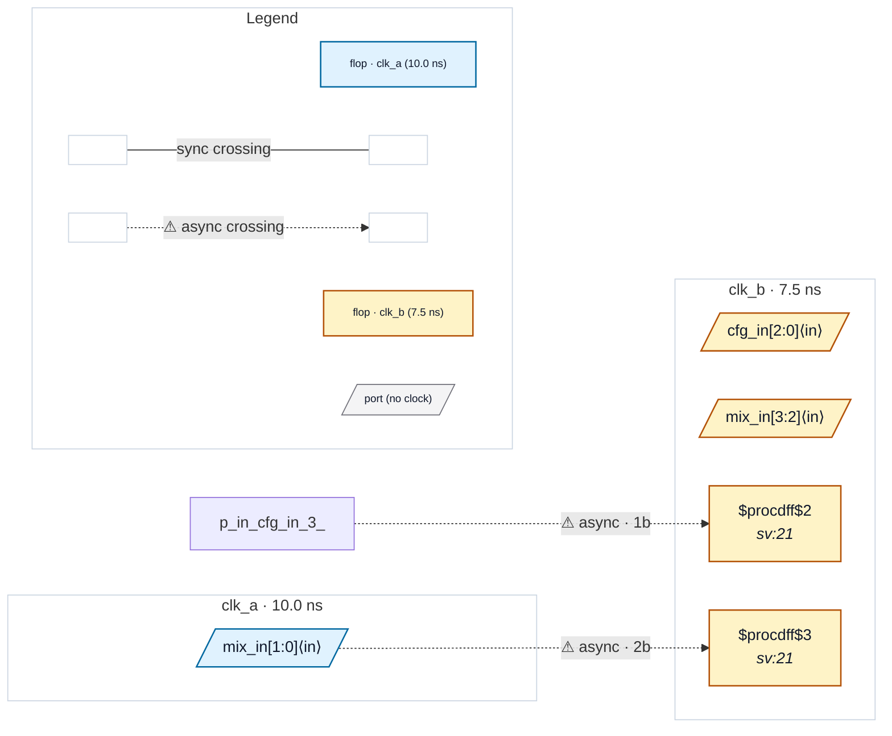

# Fixture: `bad_partial_bus_port_typing`

<!-- generator: scripts/gen_fixture_docs.py -->

Negative-case fixture for per-bit port typing (rtl-buddy-cdc#394).

Two 4-bit input buses are registered in `clk_b`. The SDC types them bit by bit: `cfg_in[2:0]` to `clk_b` (a same-domain capture), with `cfg_in[3]` taken out by `remove_from_collection` and so left untyped; `mix_in[1:0]` to `clk_a` and `mix_in[3:2]` to `clk_b`. Expected: the excluded bit `cfg_in[3]` is an unconstrained input (CDC-011, warning) while the typed bits `cfg_in[2:0]` cross nothing, and `mix_in[1:0]` is a 2-bit `clk_a` -> `clk_b` crossing with no synchroniser while `mix_in[3:2]` cross nothing.

- **Status:** negative — analyzer must report a violation
- **Top module:** `bad_partial_bus_port_typing`
- **Clocks:** `clk_a` (10.0 ns), `clk_b` (7.5 ns)
- **Crossings:** 2 structural (2 async-per-SDC, 0 sync)

## Clock-domain map

## Files

- `bad_partial_bus_port_typing.json`
- `bad_partial_bus_port_typing.sdc`
- `bad_partial_bus_port_typing.sv`

---
*Generated by `scripts/gen_fixture_docs.py` — re-run after editing the SV/SDC/netlist.*
