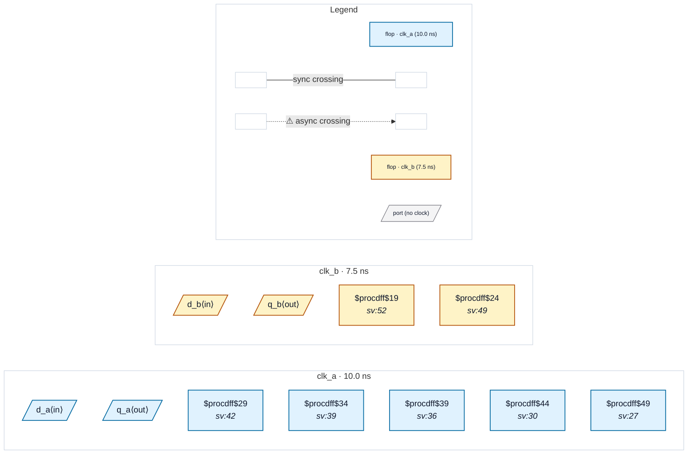

# Fixture: `bad_primary_reset_bypassed_sync`

<!-- generator: scripts/gen_fixture_docs.py -->

RDC-008 in both of its shapes (rtl-buddy-cdc#398).

The reset port rst_n has a 2FF reset synchroniser in clk_a (sync_meta -> sync_rst_n), so the design knows the port needs one.

```text
  clk_a  a_ok resets from the synchroniser's tail; a_raw0 / a_raw1
         take the raw port instead and bypass the synchroniser this
         domain already has. RDC-008 names its tail.
  clk_b  b_raw0 / b_raw1 take the raw port and clk_b has no
         synchroniser for it. RDC-008 asks for one.
```

Either way the deassertion edge reaches those flops unsynchronised to their clock. RDC-008 must fire once per clock and nothing else.

- **Status:** negative — analyzer must report a violation
- **Top module:** `bad_primary_reset_bypassed_sync`
- **Clocks:** `clk_a` (10.0 ns), `clk_b` (7.5 ns)
- **Crossings:** 0 structural (0 async-per-SDC, 0 sync)

## Clock-domain map



## Files

- `bad_primary_reset_bypassed_sync.json`
- `bad_primary_reset_bypassed_sync.sdc`
- `bad_primary_reset_bypassed_sync.sv`

---
*Generated by `scripts/gen_fixture_docs.py` — re-run after editing the SV/SDC/netlist.*
