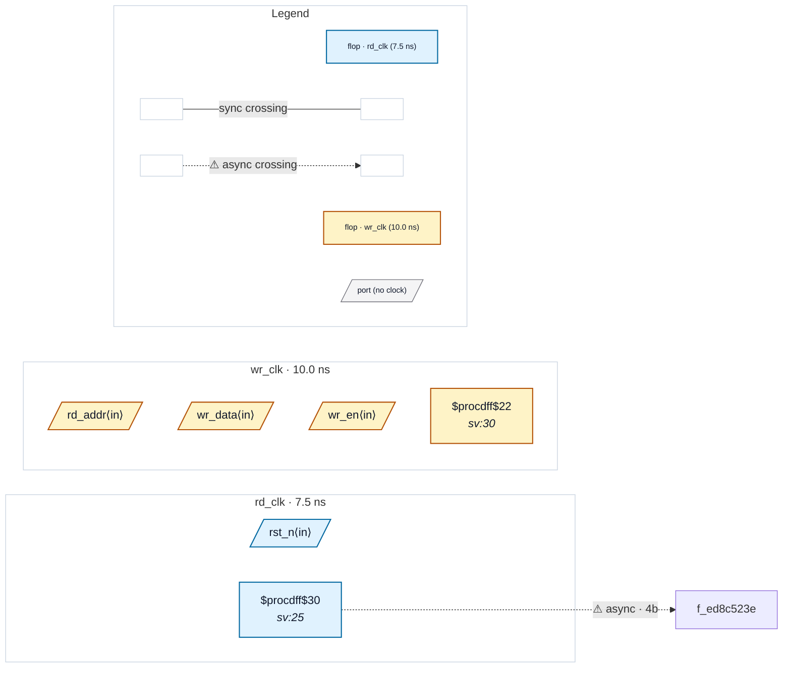

# Fixture: `bad_ram_write_addr_wrong_domain`

<!-- generator: scripts/gen_fixture_docs.py -->

Negative fixture (issue #326): a memory write port fed from the wrong clock domain.

The RAM is written and read on `wr_clk` only — the storage itself never crosses a clock, so CDC-026 has nothing to say. But the write *address* is a counter clocked on the asynchronous `rd_clk`, wired straight into the `wr_clk` write port with no synchroniser. A memory write port is a sink in its write-clock domain, so this is an ordinary unsynchronised multi-bit crossing into it: CDC-004 must fire on the counter -> write-port path, and nothing else.

- **Status:** negative — analyzer must report a violation
- **Top module:** `bad_ram_write_addr_wrong_domain`
- **Clocks:** `rd_clk` (7.5 ns), `wr_clk` (10.0 ns)
- **Crossings:** 1 structural (1 async-per-SDC, 0 sync)
- **Memory crossings:** 0 write→read storage path(s) (0 async-per-SDC)

## Clock-domain map

## Files

- `bad_ram_write_addr_wrong_domain.json`
- `bad_ram_write_addr_wrong_domain.sdc`
- `bad_ram_write_addr_wrong_domain.sv`

---
*Generated by `scripts/gen_fixture_docs.py` — re-run after editing the SV/SDC/netlist.*
