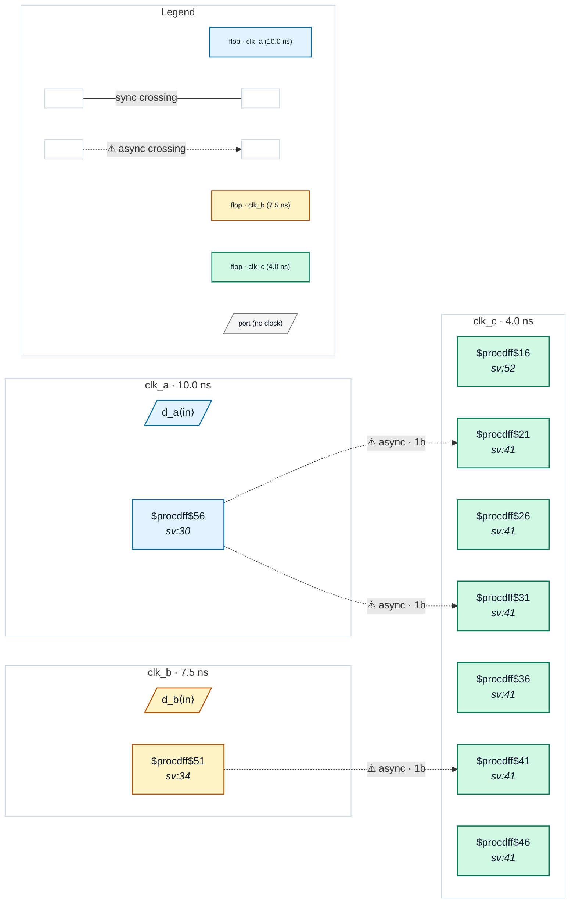

# Fixture: `bad_reconvergence_three_domains`

<!-- generator: scripts/gen_fixture_docs.py -->

Negative fixture: reconvergence in a third domain, with a second source domain feeding the same recombination point (rtl-buddy-cdc#331).

clk_a, clk_b and clk_c are mutually asynchronous. a_q (clk_a) fans out to TWO independent 2FF synchronisers in clk_c, and b_q (clk_b) to one; all three synchronised values meet in one clk_c register. The two copies of a_q can resolve a clk_c cycle apart, so the combine can see a pair of a_q values that never coexisted: CDC-005 fires exactly once, for source a_q into clk_c. b_q has one synchroniser, so it is not a reconvergent source although it reaches the same gate, and its presence must not add a second CDC-005. Every crossing has depth 2: no CDC-001 / CDC-002.

```text
  clk_a [a_q] ──2FF──┐
              └─2FF──┼─ & | ─▶ [c_mix] (clk_c)   → CDC-005 (a_q)
  clk_b [b_q] ──2FF──┘
```

- **Status:** negative — analyzer must report a violation
- **Top module:** `bad_reconvergence_three_domains`
- **Clocks:** `clk_a` (10.0 ns), `clk_b` (7.5 ns), `clk_c` (4.0 ns)
- **Crossings:** 3 structural (3 async-per-SDC, 0 sync)

## Clock-domain map



## Files

- `bad_reconvergence_three_domains.json`
- `bad_reconvergence_three_domains.sdc`
- `bad_reconvergence_three_domains.sv`

---
*Generated by `scripts/gen_fixture_docs.py` — re-run after editing the SV/SDC/netlist.*
