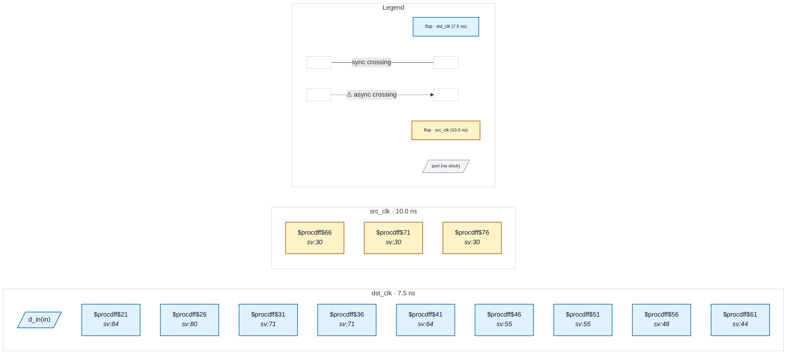

# Fixture: `bad_reset_sync_foreign_reg`

<!-- generator: scripts/gen_fixture_docs.py -->

Foreign-domain resets that are NOT synchronised (rtl-buddy-cdc#367).

Three src_clk registers each drive dst_clk async resets. RDC-001 exempts the flops of a recognised reset synchroniser, and nothing else; this pins what still fires:

```text
- `a1_rst_n` -> one flop `single` (D tied to 1) whose Q resets
  `q1`. One stage is not a synchroniser: RDC-001 on `single`.
- `a2_rst_n` -> a two-flop chain whose head loads the *asserted*
  value (D tied to 0 on an active-low reset). That chain never
  deasserts (RDC-007) and is not a synchroniser: RDC-001 on it.
- `a3_rst_n` -> a correct two-flop synchroniser (silent) and, on the
  raw reset, an ordinary data flop `q3_raw`: RDC-001 is reported on
  `q3_raw` and lists only it.
```

Paired with `good_reset_sync_foreign_reg`.

- **Status:** negative — analyzer must report a violation
- **Top module:** `bad_reset_sync_foreign_reg`
- **Clocks:** `dst_clk` (7.5 ns), `src_clk` (10.0 ns)
- **Crossings:** 0 structural (0 async-per-SDC, 0 sync)

## Clock-domain map



## Files

- `bad_reset_sync_foreign_reg.json`
- `bad_reset_sync_foreign_reg.sdc`
- `bad_reset_sync_foreign_reg.sv`

---
*Generated by `scripts/gen_fixture_docs.py` — re-run after editing the SV/SDC/netlist.*
