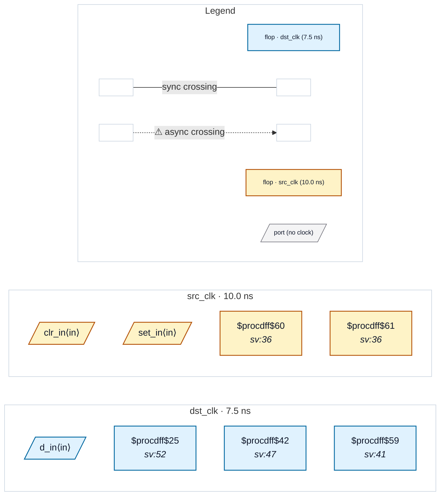

# Fixture: `bad_set_clear_foreign_controls`

<!-- generator: scripts/gen_fixture_docs.py -->

Set / clear flops whose async controls are wrong (rtl-buddy-cdc#383, rtl-buddy-cdc#378).

`proc` writes a set / clear flop as a `$dffsr` whose CLR and SET are built from muxes: an active-low control becomes an inverter mux, and the lower-priority pin is gated by the higher one (`SET = rst_n ? ~set_n : 0`). That encoding is not reset logic; what drives it is:

```text
  qa  SET from `set_q`, a src_clk register          RDC-001
  qb  SET from `sel ? set_a_n : set_b_n` (a mux)    RDC-006
  qc  CLR from `clr_q`, a src_clk register          RDC-001
```

qa and qc share no source, so RDC-001 fires twice. qc's CLR is the buffer mux `clr_q ? 1 : 0`: a register, not combinational logic, so no RDC-004. Every flop's clear or set from the ports `rst_n` / `set_n` is clean. The committed `.synth.json` (`opt_dff; techmap; abc`) holds the gate-level form (`$_DFFSR_*`, `$_NOT_` / `$_AND_` on R and S) and must agree.

- **Status:** negative — analyzer must report a violation
- **Top module:** `bad_set_clear_foreign_controls`
- **Clocks:** `dst_clk` (7.5 ns), `src_clk` (10.0 ns)
- **Crossings:** 0 structural (0 async-per-SDC, 0 sync)

## Clock-domain map



## Files

- `bad_set_clear_foreign_controls.json`
- `bad_set_clear_foreign_controls.sdc`
- `bad_set_clear_foreign_controls.sv`
- `bad_set_clear_foreign_controls.synth.json`

---
*Generated by `scripts/gen_fixture_docs.py` — re-run after editing the SV/SDC/netlist.*
