# Fixture: `bad_set_clear_reset_polarity`

<!-- generator: scripts/gen_fixture_docs.py -->

Reset polarity of set / clear flops (rtl-buddy-cdc#394).

`proc` writes a set / clear flop as a `$dffsr` with active-high CLR and SET pins, so an active-low clear becomes an inverter mux in front of CLR. RDC-002 compares the polarity the reset signal acts with, not the pin's: `rst_n` is declared active low and every clear below that is written `negedge` must be clean.

```text
  q_ok    clear from `rst_n` (negedge)                    clean
  q_ok_f  clear from `r_lo`, a flop that resets to 0      clean
  q_bad   clear from `rst_n`, but `posedge`               RDC-002 (port)
  q_bad_f clear from `r_lo`, but `posedge`                RDC-002 (flop)
  s1, s2  a reset synchroniser of `arst_n`, built from set /
          clear flops; its head loads 1, the deassertion
          value of the active-low clear; q_sy takes its
          output                                       clean (RDC-007)
```

The committed `.synth.json` holds the gate-level form (`$_DFFSR_*`) and must agree.

- **Status:** negative — analyzer must report a violation
- **Top module:** `bad_set_clear_reset_polarity`
- **Clocks:** `clk` (10.0 ns)
- **Crossings:** 0 structural (0 async-per-SDC, 0 sync)

## Clock-domain map

```mermaid
%% bad_set_clear_reset_polarity — generated by rtl-buddy-cdc render
flowchart LR
  subgraph clk_clk["clk · 10.0 ns"]
    direction TB
    p_in_d_in[/"d_in⟨in⟩"/]:::ckcls_clk
    f_1346d110["$procdff$103<br/><i>sv:46</i>"]:::ckcls_clk
    f_50f944bd["$procdff$120<br/><i>sv:41</i>"]:::ckcls_clk
    f_75401ab5["$procdff$125<br/><i>sv:37</i>"]:::ckcls_clk
    f_940a6aff["$procdff$22<br/><i>sv:67</i>"]:::ckcls_clk
    f_eedc3c43["$procdff$39<br/><i>sv:62</i>"]:::ckcls_clk
    f_c1e5eca2["$procdff$56<br/><i>sv:62</i>"]:::ckcls_clk
    f_e215f081["$procdff$71<br/><i>sv:56</i>"]:::ckcls_clk
    f_95136375["$procdff$86<br/><i>sv:51</i>"]:::ckcls_clk
  end
  style clk_clk fill:none,stroke:#cbd5e1
  classDef ckcls_clk fill:#e0f2fe,stroke:#0369a1,stroke-width:1.5px,color:#0f172a
  classDef port_unassigned fill:#f4f4f5,stroke:#71717a,color:#0f172a
  classDef ckcls_legend_neutral fill:#ffffff,stroke:#cbd5e1,stroke-width:1px,color:#0f172a
```



## Files

- `bad_set_clear_reset_polarity.json`
- `bad_set_clear_reset_polarity.optdff.json`
- `bad_set_clear_reset_polarity.sdc`
- `bad_set_clear_reset_polarity.sv`
- `bad_set_clear_reset_polarity.synth.json`

---
*Generated by `scripts/gen_fixture_docs.py` — re-run after editing the SV/SDC/netlist.*
