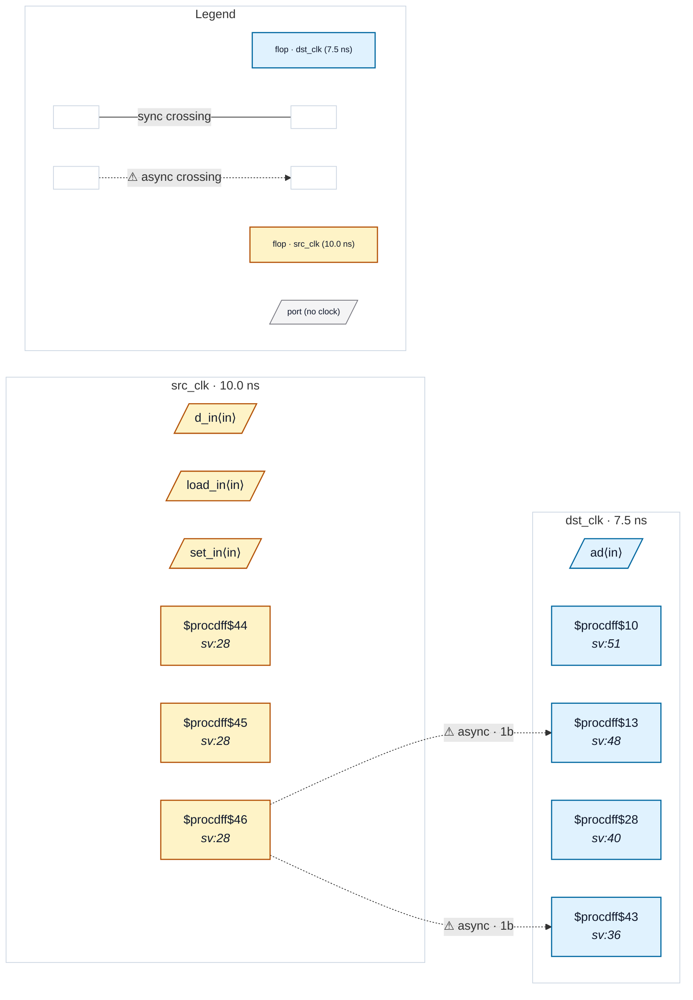

# Fixture: `bad_sync_chain_foreign_set`

<!-- generator: scripts/gen_fixture_docs.py -->

CDC-015 on every asynchronous control pin (rtl-buddy-cdc#390).

Two 2FF synchronisers in dst_clk, each released by a src_clk register on a pin other than ARST:

```text
  s1 / s2  $dffsr: CLR from the dst_rst_n port, SET from set_q   CDC-015
  l1 / l2  $aldff: ALOAD from load_q                             CDC-015
```

set_q and load_q are src_clk registers, so every release of the set or the load races dst_clk. CDC-015 used to read ARST only and missed both chains; RDC-001 (which walks every async pin) reports each foreign source once. The synchroniser data path is clean: no CDC-001 / -002. The committed `.synth.json` (`opt_dff; techmap; abc`) holds the gate-level form (`$_DFFSR_*`, `$_ALDFF_*`) and must agree.

- **Status:** negative — analyzer must report a violation
- **Top module:** `bad_sync_chain_foreign_set`
- **Clocks:** `dst_clk` (7.5 ns), `src_clk` (10.0 ns)
- **Crossings:** 2 structural (2 async-per-SDC, 0 sync)

## Clock-domain map



## Files

- `bad_sync_chain_foreign_set.json`
- `bad_sync_chain_foreign_set.sdc`
- `bad_sync_chain_foreign_set.sv`
- `bad_sync_chain_foreign_set.synth.json`

---
*Generated by `scripts/gen_fixture_docs.py` — re-run after editing the SV/SDC/netlist.*
