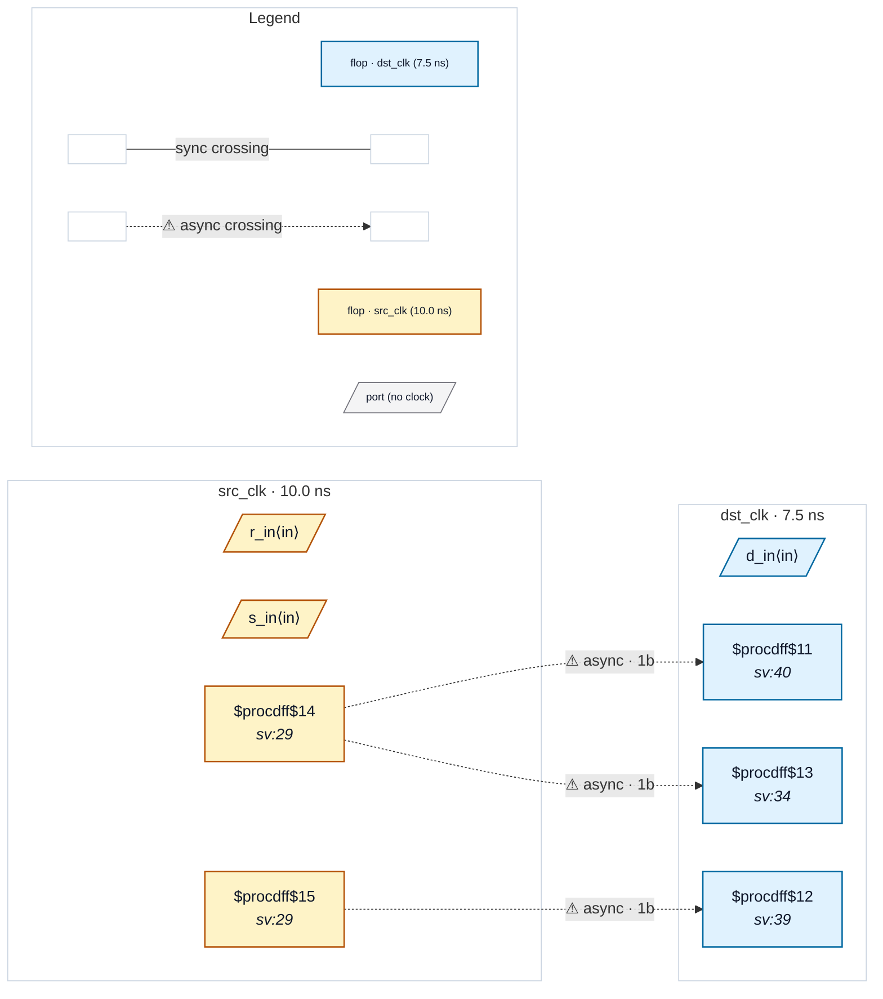

# Fixture: `bad_sync_reset_foreign_select`

<!-- generator: scripts/gen_fixture_docs.py -->

A synchronous reset driven from another clock domain, in the `proc` and the `opt_dff` form (rtl-buddy-cdc#383).

`r` is a src_clk register used as the synchronous reset of two dst_clk flops: `q`, whose data is a dst_clk input, and `s2`, the second stage of a 2FF synchroniser for `s`. After `proc` each reset is a constant-leg `$mux` on `D` selected by `r`; after `opt_dff` it is the `SRST` pin of an `$sdff`. Both netlists are committed (`.json` and `.optdff.json`) and must report the same:

```text
  r -> q    CDC-001  the crossing into q arrives only through its reset
  r -> s2   CDC-001  likewise for s2 (a second crossing, not s's)
  r         RDC-003  one finding for the shared foreign reset (q, s2)
```

`s` -> `s1` -> `s2` is still a 2FF synchroniser: s2's reset only forces it to 0, so the chain walk steps over the mux in the `proc` form as it reads straight through the `$sdff` in the `opt_dff` form.

- **Status:** negative — analyzer must report a violation
- **Top module:** `bad_sync_reset_foreign_select`
- **Clocks:** `dst_clk` (7.5 ns), `src_clk` (10.0 ns)
- **Crossings:** 3 structural (3 async-per-SDC, 0 sync)

## Clock-domain map



## Files

- `bad_sync_reset_foreign_select.json`
- `bad_sync_reset_foreign_select.optdff.json`
- `bad_sync_reset_foreign_select.sdc`
- `bad_sync_reset_foreign_select.sv`

---
*Generated by `scripts/gen_fixture_docs.py` — re-run after editing the SV/SDC/netlist.*
