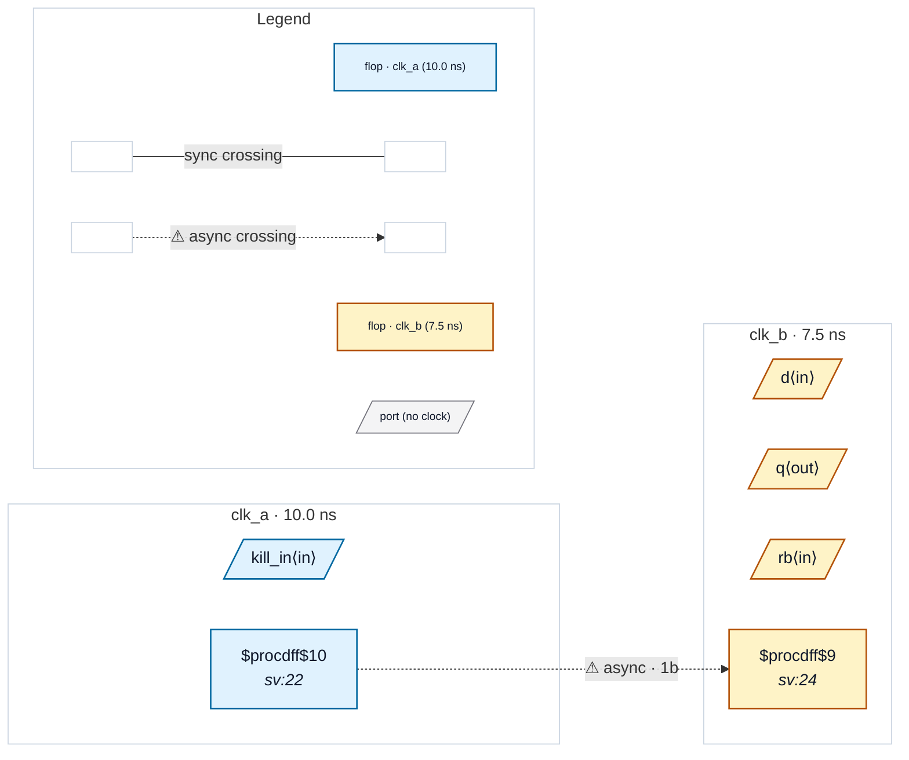

# Fixture: `bad_sync_reset_lane_crossing`

<!-- generator: scripts/gen_fixture_docs.py -->

A synchronous reset from another clock domain on some lanes of a register only (rtl-buddy-cdc#398).

kill_a is a clk_a register. In clk_b, lanes 1:0 of q reset on kill_a, lanes 3:2 on the local port rb. `opt_dff` slices q into one `$sdff` per reset; `proc` leaves one `$dff` with both resets as constant-leg muxes on D. Either way the kill_a reset reaches clk_b unsynchronised: RDC-003 must fire once, naming kill_a, in both forms, and the reset-domain map must record the crossing on lanes 1:0 only. The crossing also reaches q's D, so the CDC rules report it as well.

- **Status:** negative — analyzer must report a violation
- **Top module:** `bad_sync_reset_lane_crossing`
- **Clocks:** `clk_a` (10.0 ns), `clk_b` (7.5 ns)
- **Crossings:** 1 structural (1 async-per-SDC, 0 sync)

## Clock-domain map

## Files

- `bad_sync_reset_lane_crossing.json`
- `bad_sync_reset_lane_crossing.optdff.json`
- `bad_sync_reset_lane_crossing.sdc`
- `bad_sync_reset_lane_crossing.sv`

---
*Generated by `scripts/gen_fixture_docs.py` — re-run after editing the SV/SDC/netlist.*
