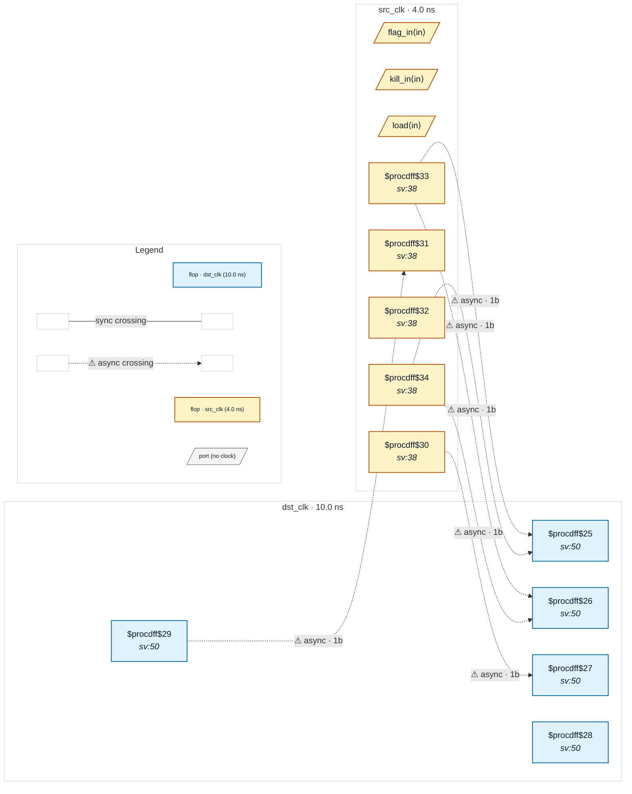

# Fixture: `bad_sync_reset_over_enable_capture`

<!-- generator: scripts/gen_fixture_docs.py -->

A crossing that reaches a handshake capture through its synchronous reset (rtl-buddy-cdc#394).

src_clk holds `flag_a` and a clear request `kill_a` until the acknowledge, synchronised back, says the transfer is done. dst_clk brings the request toggle in through three flops and captures on the toggle edge (`s2 ^ s3`), which qualifies the `flag_a` crossing of both captures below. `kill_a` is also a src_clk register, used as their synchronous reset:

```text
  f_rov  `if (kill_a) clear; else if (edge) load`: the reset wins over
         the enable (`$sdffe` once folded), so `kill_a` is sampled on
         every dst_clk edge                               CDC-001
  f_eor  `if (edge) begin if (kill_a) clear; else load; end`: the
         reset acts only under the enable (`$sdffce`), so `kill_a` is
         captured the way `flag_a` is                     no CDC-001
```

Both foreign sync resets are RDC-003 (one finding, grouped by source). The `.optdff.json` netlist is the same design after `opt_dff`; the verdict must not change.

- **Status:** negative — analyzer must report a violation
- **Top module:** `bad_sync_reset_over_enable_capture`
- **Clocks:** `dst_clk` (10.0 ns), `src_clk` (4.0 ns)
- **Crossings:** 6 structural (6 async-per-SDC, 0 sync)

## Clock-domain map



## Files

- `bad_sync_reset_over_enable_capture.json`
- `bad_sync_reset_over_enable_capture.optdff.json`
- `bad_sync_reset_over_enable_capture.sdc`
- `bad_sync_reset_over_enable_capture.sv`
- `bad_sync_reset_over_enable_capture.synth.json`

---
*Generated by `scripts/gen_fixture_docs.py` — re-run after editing the SV/SDC/netlist.*
