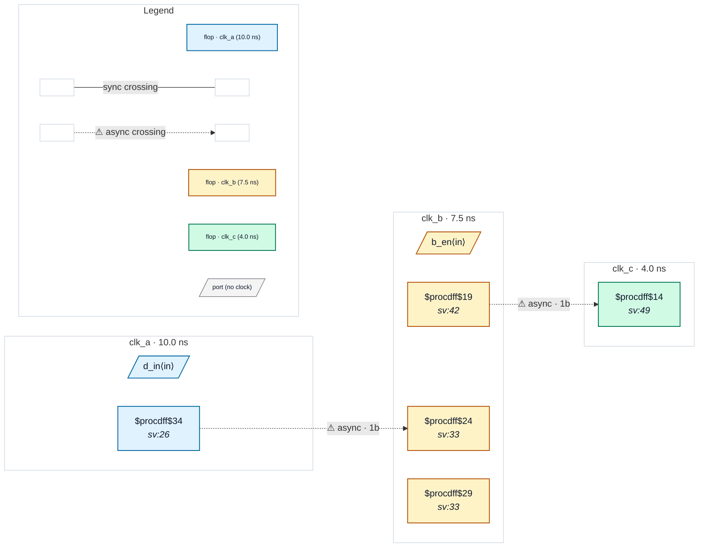

# Fixture: `bad_three_domain_chain`

<!-- generator: scripts/gen_fixture_docs.py -->

Negative fixture: a three-domain relay A → B → C with the second hop unsynchronised (rtl-buddy-cdc#331).

Same clocks and SDC as good_three_domain_chain: clk_a, clk_b and clk_c are three groups of one set_clock_groups -asynchronous. The A → B hop is a correct 2FF synchroniser; the B → C hop is captured by a single clk_c flop that drives the output directly. CDC-001 must fire exactly once, on the B → C crossing (b_q → c_s1), and nothing on the synchronised A → B hop.

```text
   clk_a          clk_b                         clk_c
  [ a_q ]──▶[ b_s1 ]─[ b_s2 ]─&─[ b_q ]──▶[ c_s1 ]──▶ q_out
  2FF at A → B; single flop at B → C → CDC-001
```

- **Status:** negative — analyzer must report a violation
- **Top module:** `bad_three_domain_chain`
- **Clocks:** `clk_a` (10.0 ns), `clk_b` (7.5 ns), `clk_c` (4.0 ns)
- **Crossings:** 2 structural (2 async-per-SDC, 0 sync)

## Clock-domain map



## Files

- `bad_three_domain_chain.json`
- `bad_three_domain_chain.sdc`
- `bad_three_domain_chain.sv`

---
*Generated by `scripts/gen_fixture_docs.py` — re-run after editing the SV/SDC/netlist.*
