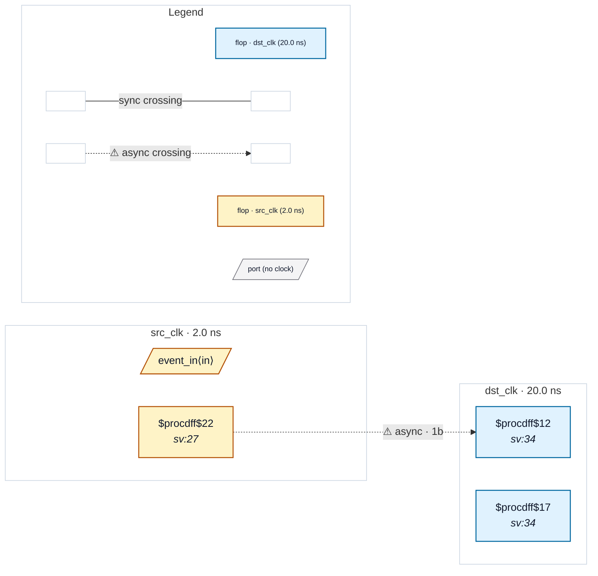

# Fixture: `bad_toggle_no_xor_tail`

<!-- generator: scripts/gen_fixture_docs.py -->

Negative fixture for CDC-013 — toggle synchroniser WITHOUT the XOR-tail pulse-reconstruction stage.

Source-side toggle flop encodes events as level changes. The destination synchronises the toggle through a 2FF chain but uses the chain tail's Q directly as the output without XOR-ing it with a 1-cycle-delayed copy. The output therefore tracks the toggle level rather than emitting one pulse per event — two closely-spaced events that toggle the source twice between two destination samples become zero events at the destination.

CDC-013 must fire on this shape; the XOR-tail suppression (added in rtl-buddy-cdc#196) only kicks in when the dst-side reconstructs the pulse properly. This fixture is the regression sentinel for "rule still catches the actual failure after the XOR-tail false-positive was suppressed".

- **Status:** negative — analyzer must report a violation
- **Top module:** `bad_toggle_no_xor_tail`
- **Clocks:** `dst_clk` (20.0 ns), `src_clk` (2.0 ns)
- **Crossings:** 1 structural (1 async-per-SDC, 0 sync)

## Clock-domain map

## Files

- `bad_toggle_no_xor_tail.json`
- `bad_toggle_no_xor_tail.sdc`
- `bad_toggle_no_xor_tail.sv`
- `bad_toggle_no_xor_tail.synth.json`

---
*Generated by `scripts/gen_fixture_docs.py` — re-run after editing the SV/SDC/netlist.*
