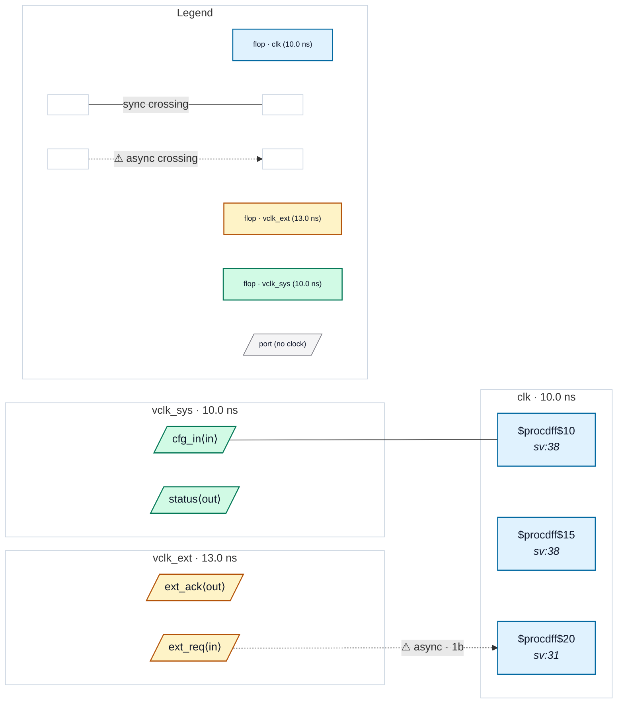

# Fixture: `bad_virtual_clock_io`

<!-- generator: scripts/gen_fixture_docs.py -->

Negative fixture: virtual clocks typing top-level inputs and outputs, with an unsynchronised input and an output launched asynchronously to its contract (rtl-buddy-cdc#331).

```text
Same clocks as good_virtual_clock_io: vclk_ext is a virtual clock
asynchronous to clk, vclk_sys a virtual clock related to it.
  ext_req  set_input_delay -clock vclk_ext, captured by ONE clk flop:
           a port-sourced async crossing with no second stage → CDC-001
  ext_ack  set_output_delay -clock vclk_ext, launched by a clk flop:
           the external receiver samples it on a clock asynchronous to
           the launch → CDC-024
  status   set_output_delay -clock vclk_sys, a gate of two clk flops
           (req_s1, cfg_q): related clocks, silent
Every output has a contract, so CDC-025 stays silent. Exactly one
CDC-001 and one CDC-024.
```

```text
  ext_req (vclk_ext) ──1FF──▶ [req_s1] clk ──&──▶ status   → CDC-001
  [cfg_q] clk ──▶ [ack_q] clk ──▶ ext_ack (vclk_ext)       → CDC-024
```

- **Status:** negative — analyzer must report a violation
- **Top module:** `bad_virtual_clock_io`
- **Clocks:** `clk` (10.0 ns), `vclk_ext` (13.0 ns), `vclk_sys` (10.0 ns)
- **Crossings:** 2 structural (1 async-per-SDC, 1 sync)

## Clock-domain map



## Files

- `bad_virtual_clock_io.json`
- `bad_virtual_clock_io.sdc`
- `bad_virtual_clock_io.sv`

---
*Generated by `scripts/gen_fixture_docs.py` — re-run after editing the SV/SDC/netlist.*
