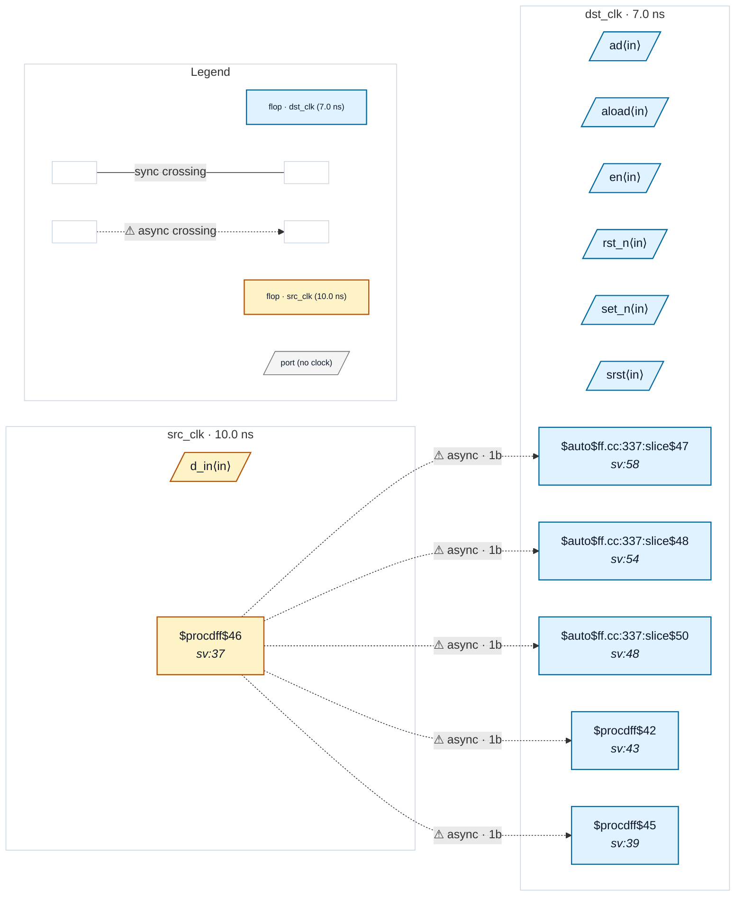

# Fixture: `flop_zoo_crossing`

<!-- generator: scripts/gen_fixture_docs.py -->

Flop-type coverage fixture (rtl-buddy-cdc#331).

Five dst_clk flops, one per Yosys flop family the rest of the corpus never produces, each capturing the src_clk flop `src_q` directly with no synchroniser. The committed netlist is built with `opt_dff` after `proc`, which folds the enable and sync-reset muxes into the flops:

```text
  q_aldff   $aldff   async load of `ad`
  q_dffsr   $dffsr   async set and async clear
  q_sdffce  $sdffce  sync reset that only acts while `en` is high
  q_adffe   $adffe   async reset plus enable
  q_dffe    $dffe    enable
```

Every capture is a single-flop crossing, so CDC-001 fires five times. RDC-006 also fires once, on `q_dffsr`: its SET and CLR pins are driven by logic derived from `rst_n` and `set_n`. The gate-level corpus (tests/test_gate_level_corpus.py) lowers the same source to `$_ALDFF_*`, `$_DFFSR_*`, `$_SDFFCE_*`, `$_DFFE_*` cells.

- **Status:** auxiliary
- **Top module:** `flop_zoo_crossing`
- **Clocks:** `dst_clk` (7.0 ns), `src_clk` (10.0 ns)
- **Crossings:** 5 structural (5 async-per-SDC, 0 sync)

## Clock-domain map



## Files

- `flop_zoo_crossing.json`
- `flop_zoo_crossing.sdc`
- `flop_zoo_crossing.sv`

---
*Generated by `scripts/gen_fixture_docs.py` — re-run after editing the SV/SDC/netlist.*
