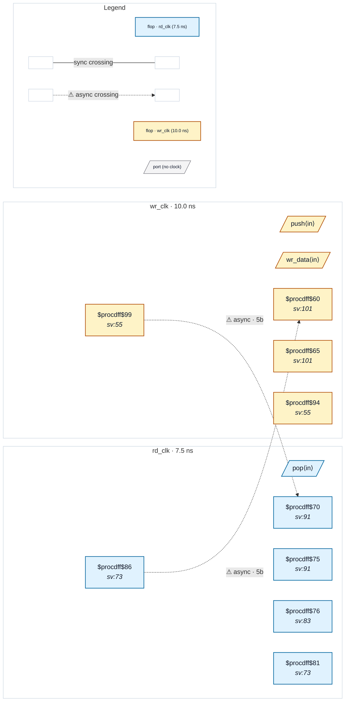

# Fixture: `good_async_fifo_inferred_ram`

<!-- generator: scripts/gen_fixture_docs.py -->

Positive fixture for CDC-026 (issue #326): the textbook async FIFO built on an inferred dual-clock RAM.

The RAM (16 x 8) is written on `wr_clk` at the binary write pointer and read on `rd_clk` at the binary read pointer. Each pointer also keeps a gray copy (`g = b ^ (b >> 1)`) that crosses to the other side through a multi-bit 2FF synchroniser:

```text
  wptr_gray_q : wr_clk -> rd_clk  (empty flag, gates the read pointer)
  rptr_gray_q : rd_clk -> wr_clk  (full flag, gates the write pointer)
```

The read port's address is the read pointer, which only advances under `pop && !empty`, and `empty` compares against the synchronised write pointer — so the read side's address logic receives the write-domain crossing. That is the sanctioned shape: CDC-026 stays silent, and CDC-004 accepts both pointer crossings via the structural gray detector. Two read ports exercise both read-domain paths: the registered `rd_data` (captured by an `rd_clk` flop) and the first-word-fall-through `rd_peek` (asynchronous read straight to an output port, whose domain comes from its address).

The flags are assigned at the bottom, after the procedural blocks that read them (a forward use both frontends must resolve). Built with the `lint` wrapper's `proc; flatten; opt_clean`.

- **Status:** positive — textbook fix; analyzer must stay silent
- **Top module:** `good_async_fifo_inferred_ram`
- **Clocks:** `rd_clk` (7.5 ns), `wr_clk` (10.0 ns)
- **Crossings:** 2 structural (2 async-per-SDC, 0 sync)
- **Memory crossings:** 2 write→read storage path(s) (2 async-per-SDC)

## Clock-domain map



## Files

- `good_async_fifo_inferred_ram.json`
- `good_async_fifo_inferred_ram.sdc`
- `good_async_fifo_inferred_ram.sv`

---
*Generated by `scripts/gen_fixture_docs.py` — re-run after editing the SV/SDC/netlist.*
