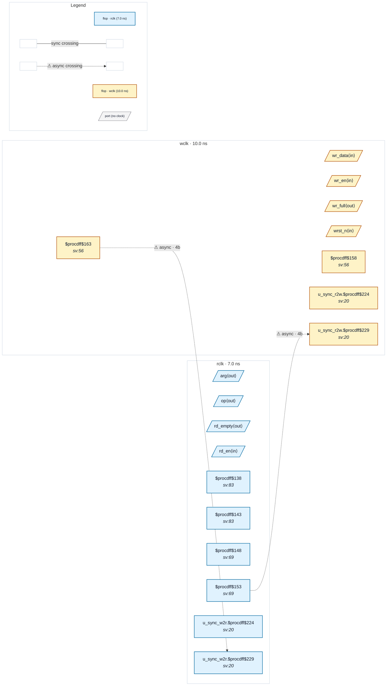

# Fixture: `good_async_fifo_reset_block`

<!-- generator: scripts/gen_fixture_docs.py -->

Async FIFO whose storage write sits in the write pointer's asynchronous-reset block (rtl-buddy-cdc#414). Because of the reset, Yosys mem2reg (and the slang frontend, rtl-buddy-cdc#401) build `mem` as DEPTH registers loaded through a decode of the write address and read through a mux on the read address, not as a memory cell; the read side then captures each word in two registers (op / arg), which used to fire CDC-020 once per word. The array has exactly the memory shape -- one write decode on wclk, one read mux on rbin -- so the analyzer judges it as the memory it is: the gray write pointer synchronised into rclk gates every read (CDC-026 is satisfied), and nothing fires.

- **Status:** positive — textbook fix; analyzer must stay silent
- **Top module:** `good_async_fifo_reset_block`
- **Clocks:** `rclk` (7.0 ns), `wclk` (10.0 ns)
- **Crossings:** 2 structural (2 async-per-SDC, 0 sync)
- **Memory crossings:** 1 write→read storage path(s) (1 async-per-SDC)

## Clock-domain map

## Files

- `good_async_fifo_reset_block.json`
- `good_async_fifo_reset_block.sdc`
- `good_async_fifo_reset_block.sv`

---
*Generated by `scripts/gen_fixture_docs.py` — re-run after editing the SV/SDC/netlist.*
