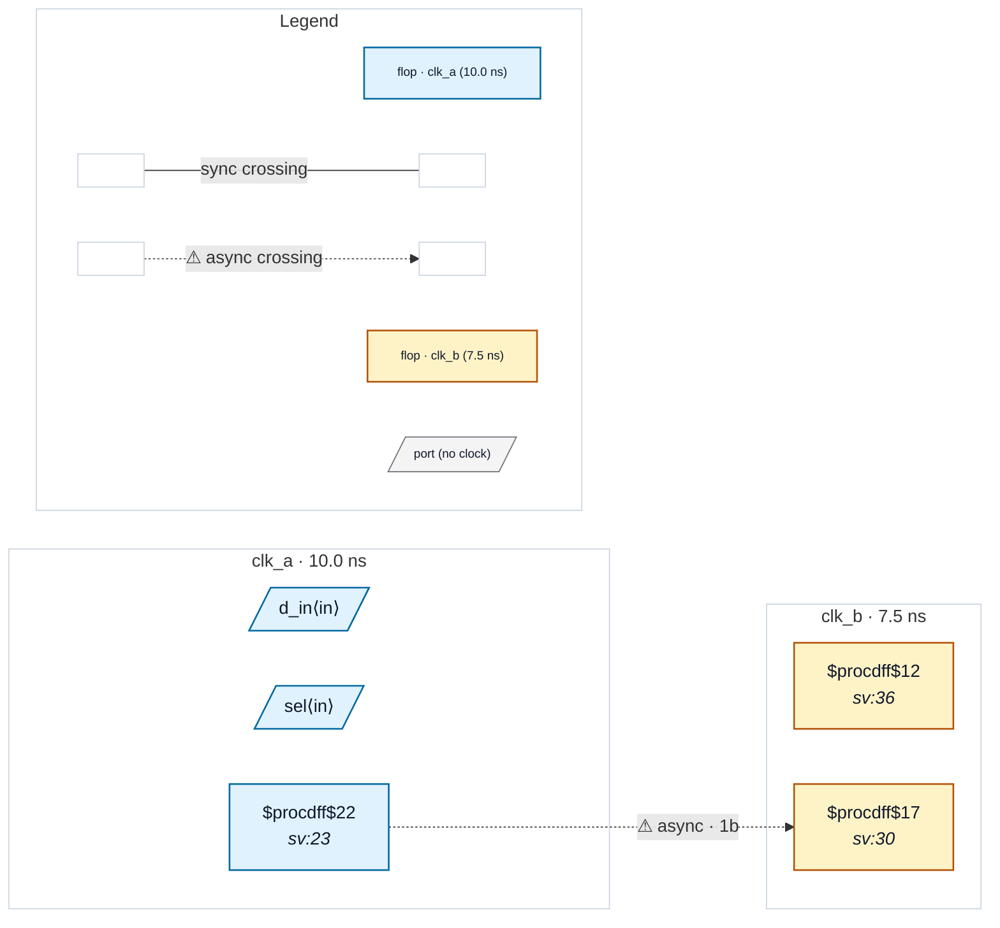

# Fixture: `good_case_analysis_clock_mux`

<!-- generator: scripts/gen_fixture_docs.py -->

Positive fixture for set_case_analysis on a clock-mux select.

Same clock mux as bad_case_analysis_clock_mux — clk_m = sel ? clk_b : clk_a — with `set_case_analysis 1 [get_ports sel]`, so the capture side is a clk_b domain in the constrained mode (rtl-buddy-cdc#325). The textbook fix is in place: src_q crosses into a 2FF synchronizer clocked by the muxed clock, so the crossing is reported as async and no rule fires.

- **Status:** positive — textbook fix; analyzer must stay silent
- **Top module:** `good_case_analysis_clock_mux`
- **Clocks:** `clk_a` (10.0 ns), `clk_b` (7.5 ns)
- **Crossings:** 1 structural (1 async-per-SDC, 0 sync)

## Clock-domain map

## Files

- `good_case_analysis_clock_mux.json`
- `good_case_analysis_clock_mux.sdc`
- `good_case_analysis_clock_mux.sv`

---
*Generated by `scripts/gen_fixture_docs.py` — re-run after editing the SV/SDC/netlist.*
