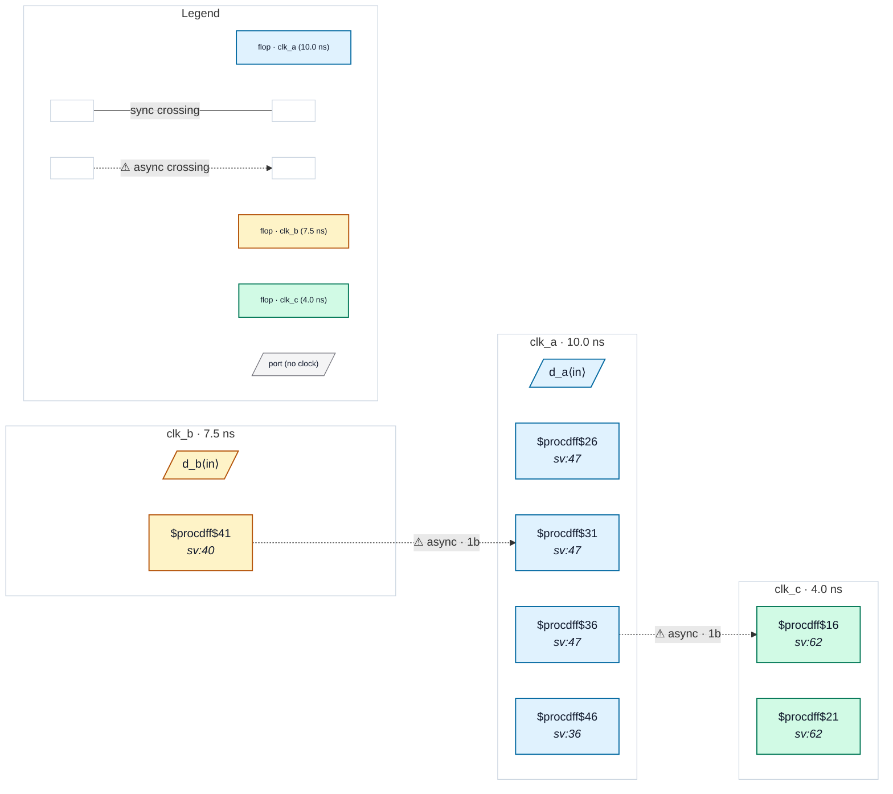

# Fixture: `good_case_analysis_mode_sel0`

<!-- generator: scripts/gen_fixture_docs.py -->

Positive fixture: set_case_analysis selects the clock-mux leg that makes a raw path same-domain (rtl-buddy-cdc#331).

Three asynchronous clocks. Block M runs on clk_m = ~mode[1] ? clk_a : clk_b (the select passes through an inverter). M captures a_q (clk_a) with a single flop and b_q (clk_b) through a 2FF synchroniser, and the synchronised b_q leaves M for clk_c through a 2FF synchroniser. The SDC pins the mode bit: `set_case_analysis 0 [get_ports {mode[1]}]`, so clk_m is clk_a. In this mode the raw a_q → m_cap path is same-domain and disappears as a crossing; the clk_b → clk_m and clk_m → clk_c crossings both have their 2FF synchroniser. Two async crossings, no finding. bad_case_analysis_mode_sel1 is the same RTL in the other mode.

```text
  clk_a ─┐                 [a_q] clk_a ──raw──▶ [m_cap]   same domain
  clk_b ─┴─ mux(~mode[1]) = clk_m   [b_q] clk_b ──2FF──▶ M
                                     M ──2FF──▶ clk_c
```

- **Status:** positive — textbook fix; analyzer must stay silent
- **Top module:** `good_case_analysis_mode_sel0`
- **Clocks:** `clk_a` (10.0 ns), `clk_b` (7.5 ns), `clk_c` (4.0 ns)
- **Crossings:** 2 structural (2 async-per-SDC, 0 sync)

## Clock-domain map



## Files

- `good_case_analysis_mode_sel0.json`
- `good_case_analysis_mode_sel0.sdc`
- `good_case_analysis_mode_sel0.sv`

---
*Generated by `scripts/gen_fixture_docs.py` — re-run after editing the SV/SDC/netlist.*
