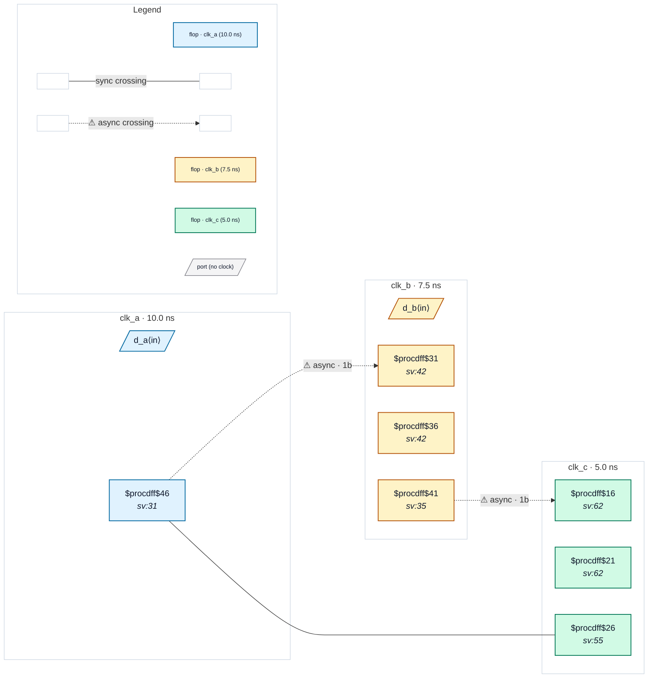

# Fixture: `good_clock_groups_two_statements`

<!-- generator: scripts/gen_fixture_docs.py -->

Positive fixture: asynchrony declared by two separate set_clock_groups statements (rtl-buddy-cdc#331).

```text
The SDC has `-asynchronous -group {clk_a} -group {clk_b}` and,
separately, `-asynchronous -group {clk_b} -group {clk_c}`. Each
statement relates only the clocks it names against each other, so
clk_a / clk_b and clk_b / clk_c are asynchronous, but no statement
separates clk_a from clk_c: that pair is still timed by STA, and the
analyzer treats clocks no group separates as synchronous. Hence:
  clk_a → clk_b   2FF, async
  clk_b → clk_c   2FF, async
  clk_a → clk_c   raw single flop, synchronous (related clocks, e.g.
                  two outputs of one PLL)
Two async crossings, no finding.
```

```text
  [a_q] clk_a ──2FF──▶ clk_b [b_q] ──2FF──▶ clk_c
  [a_q] clk_a ───────raw─────────────────▶ clk_c [c_cap]
```

- **Status:** positive — textbook fix; analyzer must stay silent
- **Top module:** `good_clock_groups_two_statements`
- **Clocks:** `clk_a` (10.0 ns), `clk_b` (7.5 ns), `clk_c` (5.0 ns)
- **Crossings:** 3 structural (2 async-per-SDC, 1 sync)

## Clock-domain map



## Files

- `good_clock_groups_two_statements.json`
- `good_clock_groups_two_statements.sdc`
- `good_clock_groups_two_statements.sv`

---
*Generated by `scripts/gen_fixture_docs.py` — re-run after editing the SV/SDC/netlist.*
