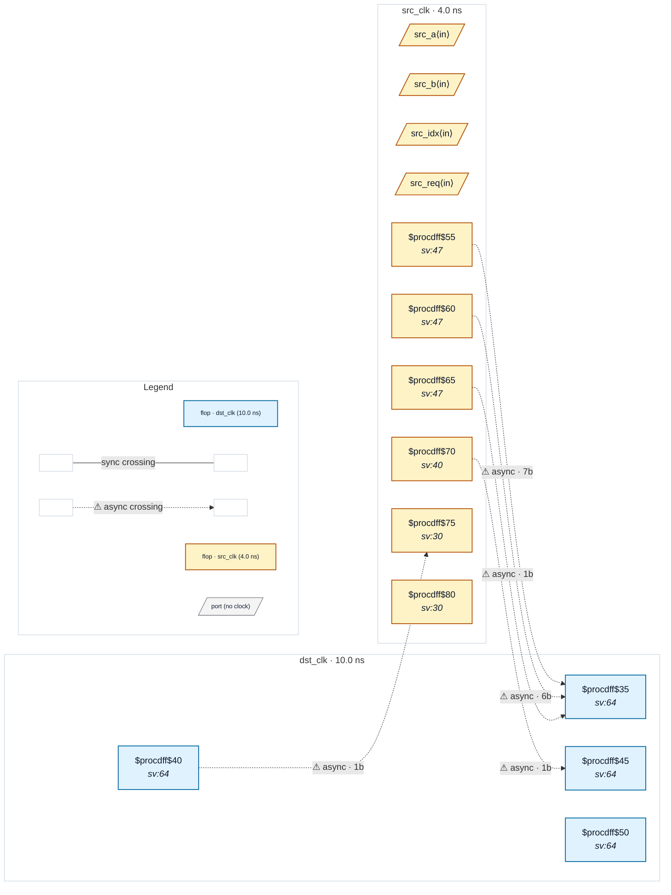

# Fixture: `good_comb_ops_handshake`

<!-- generator: scripts/gen_fixture_docs.py -->

Wider combinational operators on a handshake-held crossing (rtl-buddy-cdc#331).

A req/ack handshake holds the src_clk operands a_q, b_q and idx_q stable, and dst_clk captures a combinational function of them on the synchronised request: `$mul` (a_q * b_q), `$le`, `$reduce_xor`, `$reduce_or` and `$shiftx` (a_q[idx_q]). The logic sits on the crossing, but its inputs do not change while the capture enable is high: the capture is a gated bus (CDC-004 silent) with an acknowledge path (CDC-012 silent). Nothing fires.

Known gap, pinned as a strict xfail: the slang frontend does not lower a_q[idx_q], so the whole concatenation becomes an opaque driver and slang sees two crossings instead of five (the verdict is clean either way).

- **Status:** positive — textbook fix; analyzer must stay silent
- **Top module:** `good_comb_ops_handshake`
- **Clocks:** `dst_clk` (10.0 ns), `src_clk` (4.0 ns)
- **Crossings:** 5 structural (5 async-per-SDC, 0 sync)

## Clock-domain map

## Files

- `good_comb_ops_handshake.json`
- `good_comb_ops_handshake.sdc`
- `good_comb_ops_handshake.sv`

---
*Generated by `scripts/gen_fixture_docs.py` — re-run after editing the SV/SDC/netlist.*
